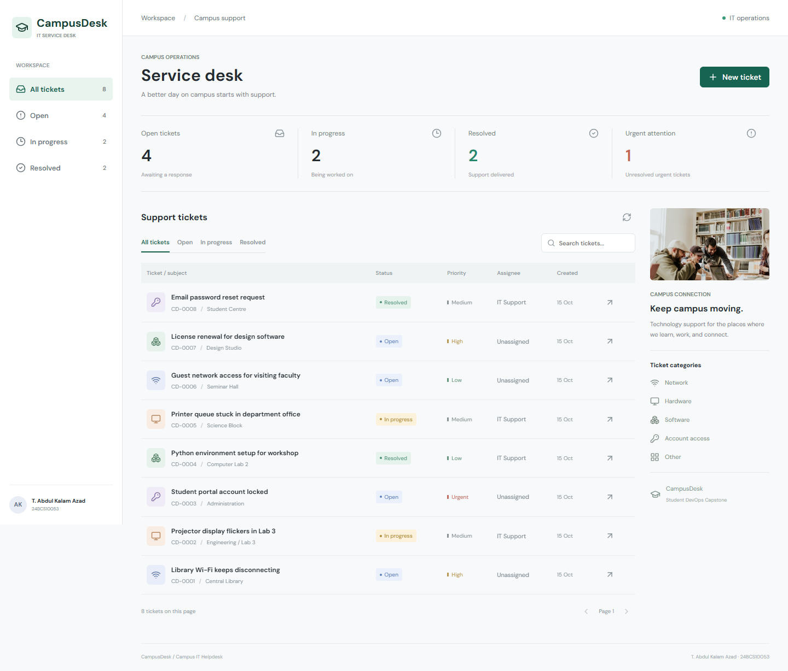
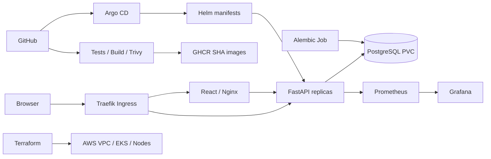

# CampusDesk

**T. Abdul Kalam Azad | 24BCS10053**

CampusDesk is a campus IT helpdesk. Students and staff report network, hardware,
software and account-access issues. The support team assigns tickets, sets priority,
tracks progress, searches requests and resolves them. The application is an original
implementation for the DevOps capstone, using the course architecture.

**Start here:** [Submission status](SUBMISSION.md) | [Demo guide](demo/WALKTHROUGH.md) |
[AWS deployment](terraform/README.md) | [Troubleshooting](troubleshooting/README.md)

**Verified locally:** 16 API tests, browser CRUD checks, healthy Compose and Kind
deployments, live monitoring, and Argo CD GitOps. The
[successful CI/CD run](https://github.com/abdulkalamazad1001/scaler-devops-homework/actions/runs/38639295103)
tested PostgreSQL, passed both application-image security gates, deployed to Kubernetes,
published images and promoted their SHA tags. See [real evidence](evidence/README.md),
[slides](demo/slides.pdf) and the [silent local walkthrough](demo/local-walkthrough.mp4).
AWS deployment and the complete student-narrated AWS video remain pending.



## Architecture



Local Kubernetes uses Kind on Docker Desktop. AWS infrastructure is a separate,
deliberately deferred deployment. Application data in Compose and Kubernetes lives
in separate PostgreSQL volumes.

## Stack

| Layer | Implementation |
|---|---|
| Frontend | React 19, Vite, Lucide icons, responsive CSS |
| API | Python 3.13, FastAPI, Pydantic validation, SQLAlchemy |
| Database | PostgreSQL 17, Alembic migration |
| Quality | Pytest, Ruff, PostgreSQL integration tests in CI |
| Containers | Non-root Python and multi-stage Nginx images |
| Automation | GitHub Actions, Trivy HIGH/CRITICAL gate, GHCR commit tags |
| Infrastructure | Terraform VPC, public/private subnets, NAT, EKS, EBS CSI |
| Deployment | Kubernetes, Helm, Traefik, HPA, readiness/liveness probes |
| GitOps | Argo CD application pointed at this repository |
| Monitoring | Prometheus per-pod scraping, Grafana provisioned dashboard |

## Local Setup

From this directory, with Docker Desktop running:

```powershell
docker compose up --build -d
python scripts/seed.py
```

- App: <http://localhost:3000>
- API docs: <http://localhost:8000/docs>
- Liveness: <http://localhost:8000/health>
- Database readiness: <http://localhost:8000/ready>
- Metrics: <http://localhost:8000/metrics>

The optional seed script inserts synthetic demonstration tickets. They are example
data, not real student requests. Compose defaults are for a loopback-only classroom
environment. Use `.env.example` to configure a different database password.

```powershell
docker compose ps
docker compose logs backend
docker compose exec postgres psql -U campusdesk -d campusdesk -c "SELECT id,title,status FROM tickets;"
docker compose down
```

`down` preserves the database volume. Adding `-v` permanently deletes local data.

## API

| Method | Route | Behavior |
|---|---|---|
| GET | `/api/tickets` | List; optional `status`, `q`, `limit`, `offset` |
| GET | `/api/tickets/{id}` | Retrieve one ticket or return 404 |
| POST | `/api/tickets` | Validate and create a ticket, return 201 |
| PUT | `/api/tickets/{id}` | Update all editable ticket fields |
| DELETE | `/api/tickets/{id}` | Delete a ticket, return 204 |
| GET | `/api/stats` | Counts by status and unresolved urgent tickets |
| GET | `/health`, `/ready`, `/metrics` | Operational endpoints |

Invalid inputs return 422. Search escapes SQL wildcard characters. Request metrics
use route templates rather than ticket IDs to avoid unbounded label cardinality.

## Tests And Development

```powershell
python -m venv .venv
.venv/Scripts/python -m pip install -r backend/requirements-dev.txt
cd backend
../.venv/Scripts/python -m pytest -v
../.venv/Scripts/python -m ruff check .
```

Tests cover CRUD, filters, counts, pagination, wildcard escaping, invalid input,
missing IDs and readiness failure. Local unit tests use isolated in-memory SQLite.
CI additionally runs them against a dedicated PostgreSQL database, with each test
inside a rolled-back transaction. No test touches application data.

For a lightweight development server, run `alembic upgrade head` and
`uvicorn app.main:app --port 8000` inside `backend`, then `npm ci` and `npm run dev`
inside `frontend`. SQLite is the development fallback when `DATABASE_URL` is unset;
both deployment paths use PostgreSQL.

## CI/CD And Security

The active workflow is at the **repository root**,
[`../.github/workflows/campusdesk.yml`](../.github/workflows/campusdesk.yml).
It triggers for capstone changes pushed to `main`, pull requests, and manual runs.

1. Ruff, Alembic, pytest against PostgreSQL, and the frontend production build run.
2. Helm and Terraform are validated without creating cloud resources.
3. Both Docker images are built and tagged with the full Git commit SHA.
4. Trivy scans both images and blocks the pipeline on any HIGH or CRITICAL finding.
5. An ephemeral Kind cluster deploys the Helm chart and runs a smoke test.
6. A successful main-branch run publishes both images to GHCR.
7. CI commits those verified SHA tags to `helm/campusdesk/values-release.json`.
   Argo CD automatically reconciles that release into the local cluster.

Test and scan reports are uploaded as workflow artifacts. There is no `continue-on-error`
on quality/security gates and no fabricated successful scan output. A failed scan must
be resolved before release. Trivy covers installed OS and application packages; it
does not establish that application authorization or business logic is secure.

Registry names:

```text
ghcr.io/abdulkalamazad1001/campusdesk-backend:<full-commit-sha>
ghcr.io/abdulkalamazad1001/campusdesk-frontend:<full-commit-sha>
```

New GHCR packages may be private. Make them public in package settings or configure
a Kubernetes image-pull Secret using a token with `read:packages`. Never commit it.

## Local Kubernetes And Helm

Install Kind, Helm 3 and kubectl; this workspace also has local tools under the
repository's ignored `tools/` directory. Build Compose images first, then run:

```powershell
powershell -ExecutionPolicy Bypass -File scripts/local-k8s.ps1
python scripts/seed.py --url http://campusdesk.localhost:8088
kubectl --context kind-campusdesk -n campusdesk get pods,svc,ingress,hpa
helm --kube-context kind-campusdesk list -n campusdesk
```

The script creates only a dedicated `campusdesk` cluster, generates local Secrets,
loads local images, installs Traefik and Metrics Server, and installs the Helm chart.
Backend and frontend each run at least two replicas. A migration Job prepares the
database before backend readiness succeeds. PostgreSQL uses a StatefulSet and PVC.

| Service | Local address |
|---|---|
| Ingress | <http://campusdesk.localhost:8088> |
| Prometheus | <http://localhost:9090> |
| Grafana | <http://localhost:3001> |

Grafana username: `admin`. Retrieve the generated password locally with
`powershell -File scripts/grafana-password.ps1`. Do not include it in screenshots.

If your system does not resolve `campusdesk.localhost`, use `curl.exe -H
"Host: campusdesk.localhost" http://127.0.0.1:8088/api/tickets` to verify routing.

## Observability And Autoscaling

The chart provisions Prometheus and Grafana. Prometheus discovers every backend
replica through a headless Service, so one replica's request counters cannot hide
another's. The Grafana dashboard `CampusDesk / Service Health` displays healthy
replicas, request rate, p95 latency, per-route traffic and status codes.

```powershell
python scripts/load.py --seconds 60 --workers 4
kubectl --context kind-campusdesk -n campusdesk get hpa
kubectl --context kind-campusdesk -n campusdesk top pods
```

The HPA targets 70% CPU and scales between two and four backend replicas. Light
traffic may not cause scaling; a configured HPA is not proof of an observed scale-out.
Prometheus defines unavailable-backend and error-ratio alerts. No external alert
notification destination is configured in the local demonstration.

## Argo CD And GitOps

[`gitops/application.yaml`](gitops/application.yaml) tracks this repository's Helm
chart on `main`. It combines local networking values with the verified GHCR image
tags in `values-release.json`. CI updates that file only after tests, scans and the
ephemeral Kubernetes smoke deployment pass. Automated sync and self-healing are
enabled; automatic pruning is disabled. Promotion commits use `[skip ci]` to avoid
an image-build loop. The cluster must have the `ghcr-pull` image-pull Secret when
registry packages are private.

Install Argo CD using `gitops/values-argocd.yaml`, then apply the Application and
`gitops/argocd-ingress.yaml`. The local Argo CD UI is at
<http://argocd.localhost:8088>. Its `admin` password is in the
`argocd-initial-admin-secret` Secret in namespace `argocd`.

Use one deployment owner at a time. Bootstrap with Helm for the Helm demonstration,
then let Argo CD reconcile the rendered resources for the GitOps demonstration.
Argo CD uses Helm as a template renderer; its syncs do not create Helm release history.
The initial Helm demonstration uses loaded local images. The GitOps demonstration
pulls the scanned registry images by immutable SHA. For AWS, replace the local
networking values with `values-aws.yaml` and configure the cloud cluster destination.

## AWS Infrastructure

[`terraform/`](terraform/) provisions two public and two private subnets, one NAT
gateway, an EKS cluster, a managed node group and an EBS CSI IAM role. EKS API access
is limited to supplied CIDRs. AWS is **prepared but deferred**, per the project owner's
choice. See [the AWS runbook](terraform/README.md) for plan, deployment and cleanup.

## Known Limits

- This is a classroom helpdesk with no authentication/RBAC; keep it local or add
  authentication before exposing real ticket data on a public network.
- PostgreSQL is a single instance. A production service needs backups, recovery
  tests, encryption policy and preferably a managed database.
- Local Prometheus and Grafana storage is ephemeral; PostgreSQL data is persistent.
- AWS plan/apply/destroy proof and a complete AWS walkthrough require a real account.
- Local screenshots cannot stand in for a successful GitHub Actions run.

## Sources

- [Current project brief](https://github.com/Nency-Ravaliya/devsecops-python/blob/main/README.md)
- [Grading rubric](https://github.com/Nency-Ravaliya/devsecops-python/blob/main/GRADING.md)
- [Submission instructions](https://github.com/Nency-Ravaliya/devsecops-python/blob/main/SUBMISSION.md)
- Campus photograph: [Unsplash source image](https://images.unsplash.com/photo-1523240795612-9a054b0db644), used as illustrative campus imagery.

The supplied repository contains `SUBMISSION.md`; no `student-guide.md` was present
when inspected. See `SUBMISSION.md` here for the evidence inventory and open items.
