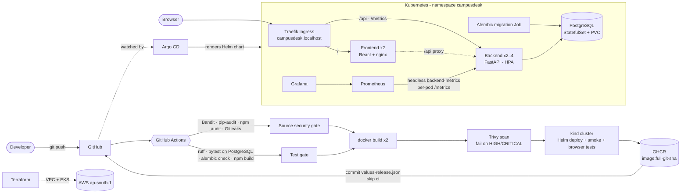
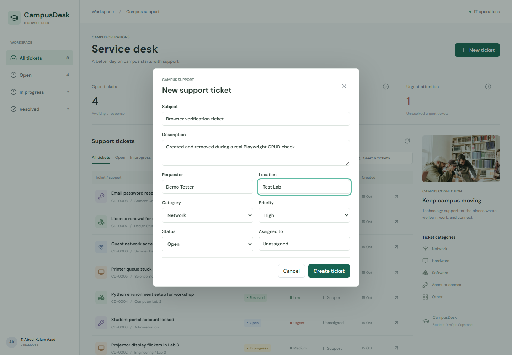
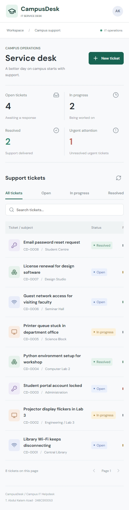
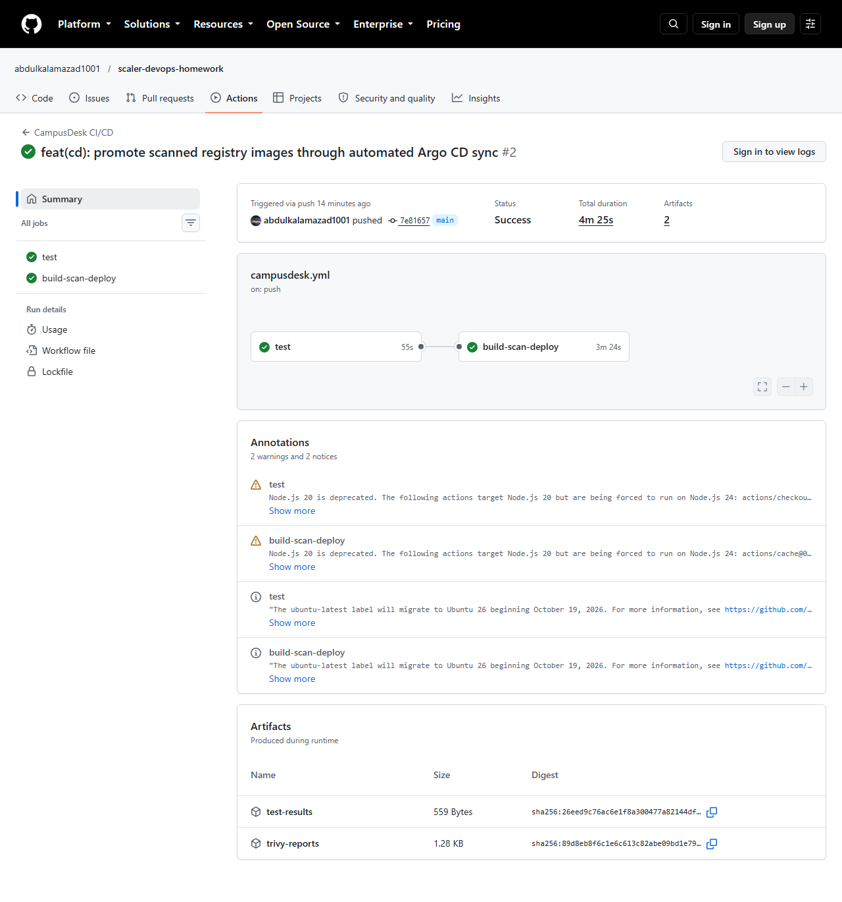
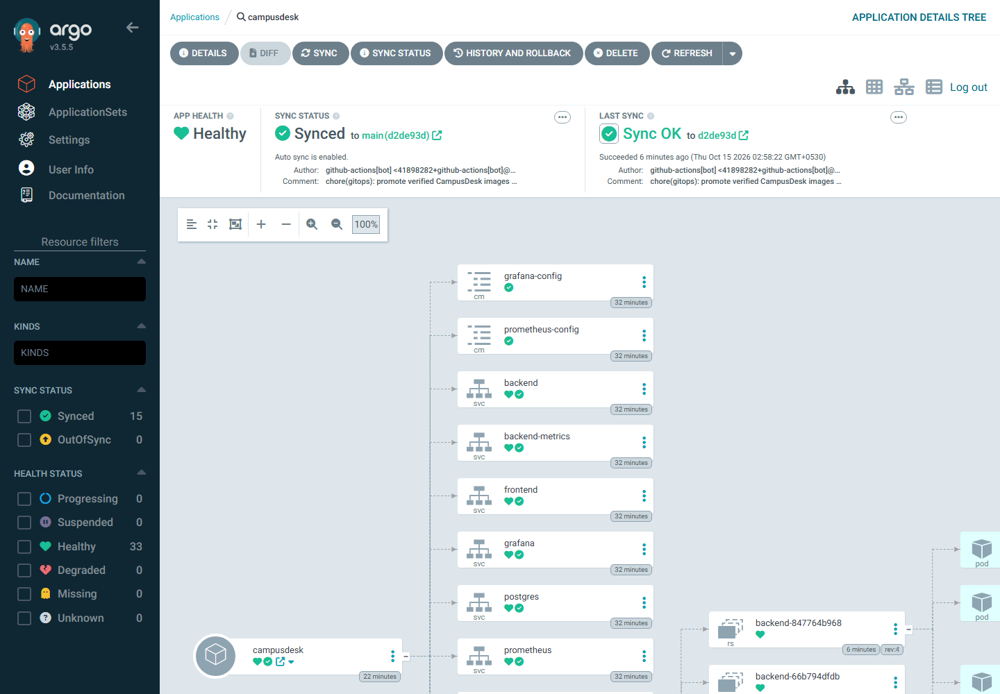
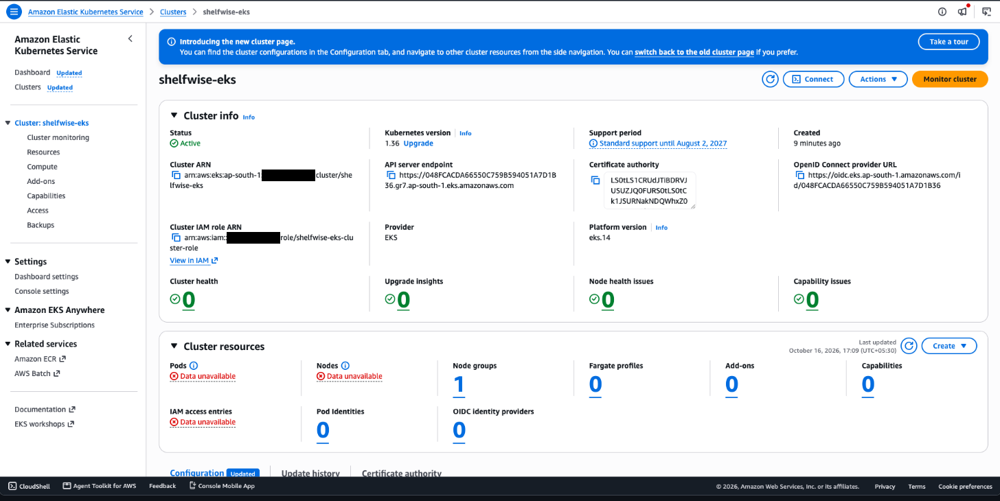
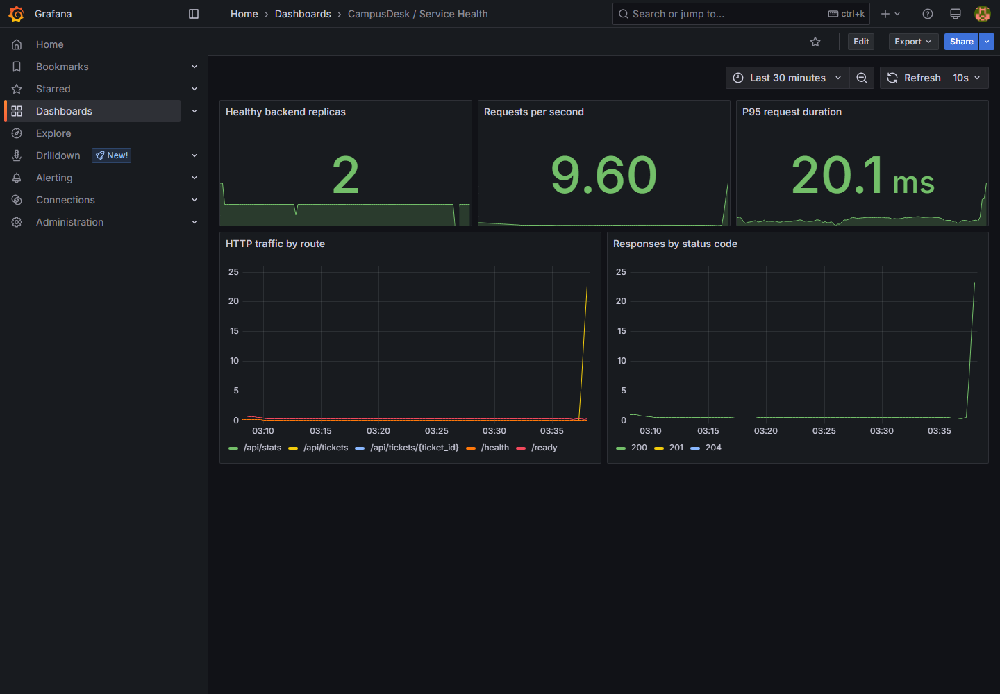

# CampusDesk: campus IT helpdesk, from laptop to GitOps-managed Kubernetes

[](https://github.com/abdulkalamazad1001/scaler-devops-homework/actions/workflows/campusdesk.yml)
· **Evidence for every grading module: [Grading evidence](#18-grading-evidence)**

**CampusDesk** is a campus IT helpdesk. Students and staff report network, hardware,
software and account-access issues. The support team assigns tickets, sets priority,
tracks progress, searches requests and resolves them.

This directory is my DevOps capstone. The application is an original implementation;
around it sits the full delivery path from the course:

```text
Developer → Git/GitHub → GitHub Actions (security gates · pytest · build · Trivy · kind deploy + browser tests · GHCR)
          → GitOps promotion → Argo CD → Helm → Kubernetes (Traefik Ingress · HPA · probes)
          → Terraform (AWS VPC + EKS) → Prometheus + Grafana → troubleshooting
```

**Author:** T. Abdul Kalam Azad (24BCS10053)


---

## Contents

1. [Architecture](#1-architecture)
2. [Tech stack](#2-tech-stack)
3. [Repository layout](#3-repository-layout)
4. [Run it locally with Docker Compose](#4-run-it-locally-with-docker-compose)
5. [The application: features and REST API](#5-the-application)
6. [Tests](#6-tests)
7. [Docker images](#7-docker-images)
8. [CI/CD pipeline](#8-cicd-pipeline)
9. [Security scanning (Trivy and source gates)](#9-security-scanning)
10. [Kubernetes + Helm](#10-kubernetes--helm)
11. [Argo CD and GitOps](#11-argo-cd-and-gitops)
12. [Terraform: AWS VPC + EKS](#12-terraform-aws-vpc--eks)
13. [Monitoring: Prometheus + Grafana](#13-monitoring-prometheus--grafana)
14. [Autoscaling demo](#14-autoscaling-demo)
15. [Troubleshooting labs](#15-troubleshooting-labs)
16. [Design decisions](#16-design-decisions)
17. [Known limits](#17-known-limits)
18. [Grading evidence](#18-grading-evidence)

---

## 1. Architecture



* The browser only calls **relative `/api/...` URLs**. Through the Ingress, `/api` goes straight
  to the backend Service; under Docker Compose the frontend's nginx proxies `/api` to the backend.
* Schema changes run once in a separate **migration Job** (an Argo CD sync hook) before the
  backend becomes ready, rather than inside every backend replica.
* The same Helm chart deploys locally on **kind** and to the Terraform-provisioned **EKS**
  cluster with `values-aws.yaml`.

A rendered version is in [evidence/architecture.png](evidence/architecture.png).

## 2. Tech stack

| Layer | Technology |
|-------|-----------|
| Frontend | React 19, Vite 6, Lucide icons, hand-written responsive CSS, served by unprivileged nginx |
| Backend | Python 3.13, FastAPI, SQLAlchemy, Pydantic, Uvicorn |
| Database | PostgreSQL 17, Alembic migrations |
| Tests | pytest (SQLite locally, PostgreSQL in CI), Ruff, Playwright browser checks |
| Containers | non-root Alpine backend image, multi-stage frontend image, Docker Compose |
| CI/CD | GitHub Actions, Trivy, Bandit, pip-audit, npm audit, Gitleaks, GHCR, kind deploy |
| GitOps | Argo CD Application tracking `main`, automated sync and self-heal |
| Infrastructure | Terraform (community `vpc`, `eks` and `iam` modules): VPC, NAT, EKS, managed node group, EBS CSI |
| Kubernetes | Helm chart, Traefik Ingress, HPA (metrics-server), startup/readiness/liveness probes |
| Observability | custom Prometheus metrics, community Prometheus + Grafana charts or built-in stack, alert rules |

## 3. Repository layout

```text
capstone-campusdesk/
├── backend/                  FastAPI service
│   ├── app/                  config, db, models, schemas, routes (main.py)
│   ├── alembic/versions/     0001_tickets
│   ├── tests/                40 pytest cases, isolated test database
│   ├── Dockerfile            Alpine, non-root (uid 10001), pip removed, HEALTHCHECK on /health
│   └── requirements*.txt     runtime / dev dependencies (pinned)
├── frontend/                 React + Vite service desk
│   ├── src/                  main.jsx, styles.css
│   ├── nginx.conf            proxies /api to the backend, /healthz for probes
│   └── Dockerfile            node build stage → nginx-unprivileged runtime (uid 101)
├── docker-compose.yml        postgres + migrate + backend + frontend
├── helm/campusdesk/          chart: deployments, services, PostgreSQL, migration Job, Ingress, HPA, monitoring
├── gitops/                   Argo CD Application, Ingress and values
├── k8s/                      namespace, kind config, Traefik values, AWS storage class
├── terraform/                AWS VPC + EKS, tfvars example, pre-destroy scripts, runbook
├── monitoring/               community Prometheus + Grafana values and install guide
├── security/                 source-security tool pins, Gitleaks config, scope notes
├── troubleshooting/          deliberately broken manifests and guide
├── scripts/                  local cluster, seed, load, browser, evidence and GitOps helpers
├── demo/                     slides, walkthrough guide, video script, recording
└── evidence/                 screenshots, command transcripts and CI artifacts
```

The CI/CD workflow lives at the repository root:
[`../.github/workflows/campusdesk.yml`](../.github/workflows/campusdesk.yml).

## 4. Run it locally with Docker Compose

Requirements: Docker Desktop (or Docker Engine + Compose v2). From this directory:

```powershell
docker compose up --build -d
python scripts/seed.py            # optional: synthetic demo tickets
```

| URL | What |
|-----|------|
| http://localhost:3000 | CampusDesk UI |
| http://localhost:8000/docs | Swagger UI: try every endpoint |
| http://localhost:8000/health · /ready · /metrics | liveness · readiness · Prometheus metrics |

```powershell
docker compose ps
docker compose logs backend
docker compose exec postgres psql -U campusdesk -d campusdesk -c "SELECT id,title,status FROM tickets;"
docker compose down               # stop, keep the database volume
docker compose down -v            # stop and delete the database volume
```

The seed data is synthetic, not real student requests. Compose defaults are for a
loopback-only classroom setup; use `.env.example` to set a different database password
(a long random alphanumeric value, not URL-encoded, because Compose interpolates it into the
connection URL).

<details>
<summary>Run the backend and frontend without Docker</summary>

```powershell
# backend (needs PostgreSQL, e.g. `docker compose up -d postgres`)
cd backend
$env:DATABASE_URL = 'postgresql+psycopg://campusdesk:<password>@localhost:5432/campusdesk'
alembic upgrade head
uvicorn app.main:app --port 8000

# frontend
cd frontend; npm ci; npm run dev
```

The backend refuses to start without `DATABASE_URL` rather than silently using a local file database.
</details>

## 5. The application

**UI features:** service-desk overview with ticket counts · ticket list with status filter and
search across title, requester and location · paginated results · create and edit ticket dialog
with category, priority, status, location and assignee · delete · loading, empty and error/retry
states · keyboard dismissal · responsive layout down to 320 px.

| Create a ticket | Mobile |
|---|---|
|  |  |

**Rules enforced by the API**

* Categories (`network`, `hardware`, `software`, `access`, `other`), priorities
  (`low` … `urgent`) and statuses (`open`, `in_progress`, `resolved`) are fixed enums.
* Title, requester, location and assignee have length limits; unknown fields are rejected.
* Invalid input returns **422**, including out-of-range IDs and NUL characters PostgreSQL cannot store.
* A failed database write is rolled back and returns **503**.
* Search escapes SQL wildcard characters, so `%` and `_` match literally.
* Request metrics use route templates, not ticket IDs, so label cardinality stays bounded.

**REST API** (full interactive docs at `/docs`)

| Method | Path | Purpose |
|--------|------|---------|
| GET | `/api/tickets` | list; filters `?status=`, `?q=` (search), `?limit=`, `?offset=` |
| GET | `/api/tickets/{id}` | one ticket, or 404 |
| POST | `/api/tickets` | validate and create, returns 201 |
| PUT | `/api/tickets/{id}` | update all editable fields |
| DELETE | `/api/tickets/{id}` | delete, returns 204 |
| GET | `/api/stats` | total, open, in progress, resolved, unresolved urgent |
| GET | `/health` | liveness: the process is up (does not touch the DB) |
| GET | `/ready` | readiness: 503 until PostgreSQL and the schema answer |
| GET | `/metrics` | Prometheus metrics (request counts, latency histograms) |

**Database** (`backend/alembic/versions/0001_tickets.py`): one `tickets` table with an index on
`status`. CI checks that the migration upgrades, matches the models (`alembic check`) and downgrades.

## 6. Tests

```powershell
python -m venv .venv
.venv/Scripts/python -m pip install -r backend/requirements-dev.txt
cd backend
../.venv/Scripts/python -m pytest -v        # 40 tests
../.venv/Scripts/python -m ruff check .
```

| Area | Tests in `backend/tests/test_api.py` |
|------|------------------------------|
| System | `/health`, `/ready`, `/metrics`; readiness failure returns 503 |
| Tickets CRUD | create, read, update, delete; missing ticket returns 404 |
| Filters | status filter, search, stats counts, stable pagination order, wildcard escaping |
| Validation | invalid fields, invalid query, out-of-range IDs, NUL in body and search, invalid update keeps the old ticket |
| Failure handling | write failure returns 503 and rolls back, unhandled errors counted, missing `DATABASE_URL` fails clearly |
| Metrics | bounded route labels, scrapes excluded |

**The tests never touch the application database.** The schema is built by the real Alembic
migration. Locally the suite uses an isolated in-memory SQLite database; CI sets
`TEST_DATABASE_URL` to a dedicated PostgreSQL service. Each test runs inside a rolled-back
transaction, and the suite refuses to start if `TEST_DATABASE_URL` equals `DATABASE_URL`.

**Browser checks** ([scripts/browser-check.mjs](scripts/browser-check.mjs)) drive the running app
with Playwright: real CRUD, validation, keyboard dismissal, narrow-screen layout and mocked
failure/pagination cases. CI runs them against its kind deployment before publishing.

```powershell
npm --prefix frontend ci
node frontend/node_modules/playwright/cli.js install chromium
node scripts/browser-check.mjs              # APP_URL selects another deployment
```

## 7. Docker images

| Image | Build | Runtime user |
|-------|-------|--------------|
| `campusdesk-backend` | `python:3.13-alpine`, `apk upgrade` at build time, dependencies installed before the code is copied, **pip uninstalled** afterwards, `HEALTHCHECK` on `/health` | uid **10001** |
| `campusdesk-frontend` | **multi-stage**: `node:24-alpine` runs `npm ci && npm run build` → `nginxinc/nginx-unprivileged:stable-alpine` serves only `dist/` on port 8080 | uid **101** |

Node never reaches the frontend runtime image, and the backend image cannot install packages at runtime.

```powershell
docker build -t campusdesk-backend:local ./backend
docker build -t campusdesk-frontend:local ./frontend
```

## 8. CI/CD pipeline

[`../.github/workflows/campusdesk.yml`](../.github/workflows/campusdesk.yml) runs on pushes to
`main` and pull requests that touch the capstone, and on manual dispatch.

```text
source-security ─┐
                 ├──▶ build-scan-deploy ──▶ publish (main only)
test ────────────┘
```

| Job | Fails the build when… |
|-----|----------------------|
| `source-security` | Bandit, pip-audit, npm audit or Gitleaks (capstone and workflow history) reports a finding |
| `test` | Ruff fails, any pytest case fails against PostgreSQL, the migration does not round-trip or drifts from the models, the frontend does not build, `helm lint`/`template` fails, or `terraform fmt`/`validate` fails |
| `build-scan-deploy` | an image does not build, **Trivy finds any HIGH/CRITICAL CVE**, the chart does not install on a fresh kind cluster, or the smoke or browser tests fail |
| `publish` | the only job with write permissions: pushes the exact scanned and tested images to `ghcr.io/abdulkalamazad1001/campusdesk-{backend,frontend}:<full commit SHA>`, never `latest`, then commits the tags to `helm/campusdesk/values-release.json` |

Main-branch runs are never cancelled midway, so a run cannot stop between publish and
promotion. Promotion commits use `[skip ci]` to avoid a build loop. Test, scan and browser
reports are uploaded as workflow artifacts; there is no `continue-on-error` on any gate.



## 9. Security scanning

**Trivy** scans each built image for known CVEs in its OS packages (Alpine `apk`) and
application libraries (Python wheels; the frontend runtime is nginx serving static files).
`exit-code: 1` with `severity: HIGH,CRITICAL` fails the job on any such finding, and because
the publish job runs only after the scan, a failing image is never pushed.

**Result: both images scan with 0 HIGH/CRITICAL findings.** That took a fix. The first
Debian-based backend image failed the gate with 48 findings, including **CVE-2025-47273** (HIGH):
a path-traversal flaw in old setuptools' package-index code that could let a crafted package
name write files outside the intended directory. The backend was rebuilt on patched Alpine
and pip/setuptools were removed after installing dependencies, since the running service never
installs packages. See [the original report](evidence/trivy-backend-initial.json) and
[the resolution notes](evidence/README.md#security-findings-and-resolution).

A clean scan means no known HIGH/CRITICAL CVE in the image's packages according to Trivy's
database at scan time. It does not prove the application logic is secure, and new CVEs can
appear later, which is why every build rescans.

**Source gates** run before any image is built: Bandit (Python source), pip-audit and npm
audit (dependencies), and redacted Gitleaks scanning of capstone and workflow history. Scope,
thresholds and local commands are in [security/README.md](security/README.md).

Other controls: non-root containers with seccomp profiles · database and Grafana passwords
generated by Helm, never committed · `.env` and `terraform.tfvars` git-ignored · AWS
credentials only from the environment · EKS API access limited to trusted CIDRs.

## 10. Kubernetes + Helm

Install kind, Helm 3 and kubectl, then with Docker running:

```powershell
powershell -ExecutionPolicy Bypass -File scripts/local-k8s.ps1
python scripts/seed.py --url http://campusdesk.localhost:8088
kubectl --context kind-campusdesk -n campusdesk get pods,svc,ingress,hpa
helm --kube-context kind-campusdesk list -n campusdesk
```

The script creates a dedicated `campusdesk` kind cluster, generates local Secrets, builds and
loads the images, installs Traefik and metrics-server, and installs the chart. It refuses to
overwrite an app already managed by Argo CD.

**What the chart (`helm/campusdesk`) creates**

| Object | Details |
|--------|---------|
| Deployment `backend` | 2 replicas, startup + liveness `/health`, readiness `/ready`, non-root, requests and limits |
| Deployment `frontend` | 2 replicas, nginx serving the React build, probes on `/healthz` |
| Services (ClusterIP) | backend, frontend, PostgreSQL, headless `backend-metrics` for per-pod scraping |
| HPA | backend 2 → 4 pods at 70% CPU |
| StatefulSet PostgreSQL | PersistentVolumeClaim (2Gi) |
| Job `campusdesk-migrate-<revision>` | runs `alembic upgrade head` once per release (Argo CD sync hook) |
| Secrets | database and Grafana passwords generated once, reused on upgrade, kept on uninstall |
| Ingress (`traefik`, `campusdesk.localhost`) | `/api`, `/metrics` → backend · `/` → frontend |
| Prometheus + Grafana (optional) | built-in stack with alert rules and the provisioned dashboard |

| Service | Local address |
|---|---|
| Ingress | http://campusdesk.localhost:8088 |
| Prometheus | http://localhost:9090 |
| Grafana | http://localhost:3001 (user `admin`, password from `scripts/grafana-password.ps1`) |

If `campusdesk.localhost` does not resolve, use
`curl.exe -H "Host: campusdesk.localhost" http://127.0.0.1:8088/api/tickets`.

## 11. Argo CD and GitOps

[`gitops/application.yaml`](gitops/application.yaml) tracks this chart on `main`, combining the
local networking values with the verified image tags in `values-release.json`. CI updates that
file only after tests, scans and the kind smoke deployment pass, so **every commit that passes the
pipeline is deployed automatically, and nothing else is**. Automated sync and self-heal are on;
automatic pruning is off.

```powershell
powershell -ExecutionPolicy Bypass -File scripts/local-gitops.ps1
```

This installs the pinned Argo CD chart, applies the Ingress and Application, and waits for
Synced/Healthy. The UI is at http://argocd.localhost:8088; the `admin` password is in the
`argocd-initial-admin-secret` Secret in namespace `argocd`.

Use one deployment owner at a time: bootstrap with Helm for the Helm demonstration, then hand
over to Argo CD. Argo CD uses Helm as a template renderer, so its syncs do not create Helm
release history.



## 12. Terraform: AWS VPC + EKS

| File | Contents |
|------|----------|
| `versions.tf` | Terraform and AWS provider versions |
| `variables.tf` | region (`ap-south-1`), cluster name, Kubernetes version (1.35), API allow-list, node sizes |
| `main.tf` | `vpc` module: **2 public + 2 private subnets** across 2 AZs, IGW, one NAT gateway · `eks` module: **EKS cluster** and **managed node group** (2 × `t3.medium`, scaling 1–3) in the private subnets · `iam` module: EBS CSI driver role |
| `outputs.tf` | ids, cluster endpoint, and the `aws eks update-kubeconfig` command |
| `terraform.tfvars.example` | copy to `terraform.tfvars` (git-ignored) |
| `scripts/pre-destroy.ps1` / `.sh` | remove Kubernetes-created load balancers and volumes so `destroy` cannot hang |

```powershell
cd terraform
copy terraform.tfvars.example terraform.tfvars
terraform init
terraform plan -out campusdesk.tfplan
terraform apply campusdesk.tfplan
aws eks update-kubeconfig --region ap-south-1 --name campusdesk-24bcs10053
powershell -ExecutionPolicy Bypass -File scripts/pre-destroy.ps1
terraform destroy
```

CI runs `terraform fmt -check`, `init -backend=false` and `validate` on every push without
creating cloud resources. The full [AWS runbook](terraform/README.md) covers prerequisites,
cost, deploying the app to EKS, screenshots and cleanup checks.

> **Where the AWS screenshots come from.** I captured the screenshots below from my
> **ShelfWise** EKS Terraform run (cluster `shelfwise-eks`, a separate hand-written VPC/EKS
> setup with 22 resources), not from the module-based CampusDesk `terraform/` folder above.
> The AWS account ID is redacted.

### Module 7 evidence

| Step | Screenshot |
|---|---|
| `terraform init`, `fmt -check -recursive`, `validate` | [00](evidence/aws/00-terraform-init-validate.png) |
| `terraform plan`, 22 to add | [01](evidence/aws/01-terraform-plan.png) |
| `terraform apply`, 22 added | [02](evidence/aws/02-terraform-apply.png) |
| VPC resource map: `10.40.0.0/16`, subnets in two AZs, route tables, IGW, NAT | [03](evidence/aws/03-vpc.png) |
| NAT gateway, available, in the public subnet | [04](evidence/aws/04-nat-gateway.png) |
| Elastic IP attached to the NAT gateway | [05](evidence/aws/05-elastic-ip.png) |
| IAM node role with the three worker policies | [06](evidence/aws/06-iam-node-role.png) |
| EKS cluster, active, Kubernetes 1.36 | [07](evidence/aws/07-eks-cluster.png) |
| Managed node group, desired size 2, active | [08](evidence/aws/08-eks-nodegroup.png) |
| Two `t3.medium` EC2 workers, private IPs only, one per AZ | [09](evidence/aws/09-ec2-worker-nodes.png) |
| `update-kubeconfig`, `kubectl get nodes -o wide`, system pods running | [10](evidence/aws/10-kubectl-get-nodes.png) |
| `terraform destroy`, 22 destroyed, then CLI checks showing nothing left | [11](evidence/aws/11-terraform-destroy.png) |
| EKS console after destroy, no clusters | [12](evidence/aws/12-eks-clusters-empty.png) |
| AWS Budgets used as cost guardrails, all `OK` | [13](evidence/aws/13-aws-budgets.png) |



## 13. Monitoring: Prometheus + Grafana

* The backend exposes `/metrics` with `campusdesk_http_requests_total` and
  `campusdesk_http_request_duration_seconds`, labelled by route template and status.
* Prometheus discovers every backend replica through the headless **`backend-metrics`**
  Service, so one replica's counters cannot hide another's.
* **Community charts (submission path):** [`monitoring/`](monitoring/) holds values for
  `prometheus-community/prometheus` and the Grafana chart, installed into namespace
  `monitoring`. Exact commands are in [monitoring/README.md](monitoring/README.md).
* **Built-in option:** `monitoring.enabled` in the app chart runs a small Prometheus and
  Grafana in the `campusdesk` namespace (used by the Argo CD deployment).
* Two alert rules: `CampusDeskBackendUnavailable` (no healthy backend for 2 minutes) and
  `CampusDeskHighErrorRate` (more than 5% 5xx responses for 5 minutes). No external
  notification destination is configured in the local demo.

The **"CampusDesk / Service Health"** dashboard is provisioned from
[`helm/campusdesk/dashboards/campusdesk.json`](helm/campusdesk/dashboards/campusdesk.json):

| Panel | Shows |
|-----|--------|
| Healthy backend replicas | how many backend pods Prometheus can scrape |
| Requests per second | overall traffic |
| P95 request duration | latency |
| HTTP traffic by route | requests per route template |
| Responses by status code | 2xx / 4xx / 5xx mix |



## 14. Autoscaling demo

```powershell
python scripts/load.py --seconds 60 --workers 4
kubectl --context kind-campusdesk -n campusdesk get hpa
kubectl --context kind-campusdesk -n campusdesk top pods
```

Under the load generator the backend HPA scaled from **2 to 4 replicas** (its maximum) at 442%
of target CPU, with 15,833 successful requests and 0 failures.
See [the HPA capture](evidence/autoscaling-output.png) and
[the load-test result](evidence/load-test.txt).

## 15. Troubleshooting labs

[`troubleshooting/`](troubleshooting/README.md) holds exercises that use separate demo objects
and never break the real backend:

| Lab | Symptom | Investigation | Fix |
|-----|---------|---------------|-----|
| [broken-image.yaml](troubleshooting/broken-image.yaml) | pods stuck in `ErrImagePull` / `ImagePullBackOff` | pod events name the tag that does not exist | `kubectl set image` to a known image, verify rollout |
| [broken-service.yaml](troubleshooting/broken-service.yaml) | Service has a ClusterIP but no endpoints | compare selector `app=nonexistent-backend` with `kubectl get pods --show-labels` | `kubectl set selector` to `app=backend` |
| Running but not ready ([script](scripts/readiness-check.py)) | pod `Running` but `0/1`, no ready endpoint | events show the readiness probe on `/missing-probe` returns 404; `/health` works directly | correct the probe path, pod becomes Ready, namespace cleaned up |
| Database or migration failure | `/ready` returns 503 | migration Job logs, PostgreSQL logs, PVC events | fix the database, rerun the Job |

Captured output: [troubleshooting.txt](evidence/troubleshooting.txt) and
[readiness-troubleshooting.txt](evidence/readiness-troubleshooting.txt).

> **Helm recovery:** `helm rollback campusdesk <revision> -n campusdesk --wait` restores chart
> configuration but does not reverse a database migration. Dependable rollback needs
> backward-compatible schema changes and backups.

## 16. Design decisions

| Decision | Why |
|----------|-----|
| Own domain (campus helpdesk) | the capstone requires an original application; the DevOps architecture follows the course |
| `/health` does not touch the DB, `/ready` does | a DB outage should stop traffic (readiness), not restart healthy pods in a loop (liveness) |
| Migrations in a separate Job, not in every replica | one migration per release, and the backend only becomes ready once the schema exists |
| Tests on PostgreSQL in CI, with a guard against the app database | catches PostgreSQL-only behaviour (such as NUL bytes) and can never wipe real data |
| Route templates as metric labels | ticket IDs as labels would create unbounded time series |
| Image tag = full commit SHA, never `latest` | immutable, traceable deployments |
| Push only from a separate `publish` job, after Trivy and the kind deploy | a vulnerable or broken image is never published, and only one job holds write permissions |
| Promotion via a committed `values-release.json` | Git is the record of what is deployed; Argo CD reconciles it |
| Argo CD pruning disabled | a bad commit cannot delete resources such as the database volume |
| Generated passwords reused on upgrade, Secrets kept on uninstall | no credential is ever committed, and the PostgreSQL volume stays readable |
| PostgreSQL as a StatefulSet in the cluster | simple classroom setup; production would use a managed database such as Amazon RDS |

## 17. Known limits

- No authentication or RBAC: keep it local, or add authentication before exposing real ticket data.
- PostgreSQL is a single instance; production needs backups, recovery tests and preferably a managed database.
- Local Prometheus and Grafana storage is ephemeral; PostgreSQL data is persistent.
- The Ingress is plain HTTP; production would add TLS (cert-manager).
- The local Helm release is owned by Argo CD after bootstrap; run `helm upgrade --install`
  against a fresh namespace or cluster, not alongside Argo CD.

## 18. Grading evidence

| Module | What is here | Evidence |
|---|---|---|
| M1 Application | FastAPI `/health`, `/ready`, CRUD on `/api/tickets`, stats; PostgreSQL via Alembic; React UI | [desktop](evidence/application-desktop.png), [create ticket](evidence/ticket-create.png), [mobile](evidence/application-mobile.png), [320 px](evidence/application-320.png), [via Ingress](evidence/application-ingress.png) |
| M2 Testing | 40 pytest cases on an isolated database, `pytest.ini` + `conftest.py`, Playwright browser checks | [pytest -v](evidence/pytest-output.png), [CI test results](evidence/ci-run-38765329150/test-results/pytest-results.xml) |
| M3 Git | public repo, scoped commits with descriptive messages, `.gitignore` | [commit history](evidence/commit-history-output.png) |
| M4 Docker | non-root backend image, multi-stage frontend (node build, nginx runtime), Compose | [compose build](evidence/compose-build-output.png), [non-root](evidence/non-root.txt) |
| M5 CI/CD | tests, build, kind deploy, GHCR push tagged with the SHA, GitOps promotion | [green run](evidence/github-actions.png), [backend image](evidence/registry-backend.png), [frontend image](evidence/registry-frontend.png) |
| M6 DevSecOps | Trivy gate on both images, source-security gates, CVE found and fixed | [Trivy backend](evidence/trivy-backend-output.png), [Trivy frontend](evidence/trivy-frontend-output.png), [initial findings](evidence/trivy-backend-initial.json) |
| M7 Terraform | VPC, 2 public + 2 private subnets, NAT, EKS + node group, `tfvars.example`; my AWS run with the ShelfWise configuration | [validate](evidence/terraform-validate-output.png), [plan](evidence/aws/01-terraform-plan.png), [apply](evidence/aws/02-terraform-apply.png), [VPC](evidence/aws/03-vpc.png), [EKS](evidence/aws/07-eks-cluster.png), [nodes](evidence/aws/10-kubectl-get-nodes.png), [destroy](evidence/aws/11-terraform-destroy.png), [all 14](#module-7-evidence) |
| M8 Kubernetes + Helm | namespace, chart, 2+ replicas each, ClusterIP services, Ingress `/` and `/api`, HPA, Argo CD | [helm](evidence/helm-output.png), [pods/svc](evidence/kubernetes-output.png), [HPA](evidence/autoscaling-output.png), [Argo CD](evidence/argocd-application.png), [labs](evidence/troubleshooting.txt) |
| M9 Observability | `/metrics`, per-pod Prometheus scraping, Grafana dashboard, alert rules | [metrics](evidence/metrics-output.png), [targets UP](evidence/prometheus-targets.png), [Grafana](evidence/grafana-dashboard.png) |
| M10 Docs + demo | this README, slides, walkthrough | [slides](demo/slides.pdf), [walkthrough](demo/WALKTHROUGH.md), [video script](demo/VIDEO-SCRIPT.md), [recording](demo/local-walkthrough.mp4) |

More detail: [evidence inventory](evidence/README.md) · [submission checklist](SUBMISSION.md) ·
[grading audit](GRADING-AUDIT.md).

**Sources:** [project brief](https://github.com/Nency-Ravaliya/devsecops-python/blob/main/README.md) ·
[grading rubric](https://github.com/Nency-Ravaliya/devsecops-python/blob/main/GRADING.md) ·
[submission instructions](https://github.com/Nency-Ravaliya/devsecops-python/blob/main/SUBMISSION.md) ·
campus photograph from [Unsplash](https://images.unsplash.com/photo-1523240795612-9a054b0db644), used as illustrative imagery.
