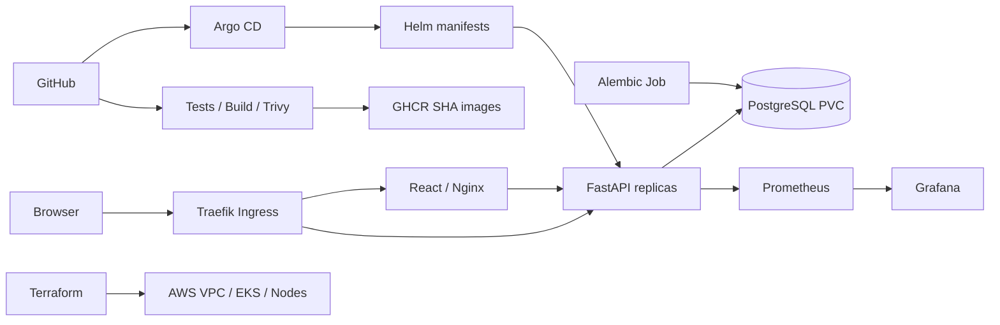

# CampusDesk

**T. Abdul Kalam Azad | 24BCS10053**

CampusDesk is a campus IT helpdesk. Students and staff report network, hardware,
software and account-access issues. The support team assigns tickets, sets priority,
tracks progress, searches requests and resolves them. The application is an original
implementation for the DevOps capstone, using the course architecture.

## Where Each Requirement Lives

| Module | What | Files |
|---|---|---|
| M1 Application | FastAPI REST API, PostgreSQL, Alembic, React UI | [`backend/app/`](backend/app/), [`backend/alembic/versions/`](backend/alembic/versions/), [`backend/requirements.txt`](backend/requirements.txt), [`frontend/`](frontend/), [`docker-compose.yml`](docker-compose.yml) |
| M2 Testing | 40 pytest cases on an isolated test database | [`backend/tests/`](backend/tests/), [`backend/pytest.ini`](backend/pytest.ini), [`backend/tests/conftest.py`](backend/tests/conftest.py) |
| M3 Git | Public repository, scoped commits, ignore rules | [`.gitignore`](.gitignore) |
| M4 Docker | Non-root images, multi-stage frontend, Compose stack | [`backend/Dockerfile`](backend/Dockerfile), [`frontend/Dockerfile`](frontend/Dockerfile), [`docker-compose.yml`](docker-compose.yml) |
| M5 CI/CD | Test, build, scan, publish SHA-tagged images to GHCR | [`../.github/workflows/campusdesk.yml`](../.github/workflows/campusdesk.yml) |
| M6 DevSecOps | Trivy gate on HIGH/CRITICAL for both images | [CI/CD And Security](#cicd-and-security) |
| M7 Terraform | VPC with public/private subnets, NAT, EKS, node group | [`terraform/`](terraform/), [runbook](terraform/README.md) |
| M8 Kubernetes + Helm | Namespace, Helm chart, 2+ replicas, ClusterIP, Ingress | [`k8s/`](k8s/), [`helm/campusdesk/`](helm/campusdesk/) |
| M9 Observability | `/metrics`, Prometheus and Grafana Helm values, dashboard | [`monitoring/`](monitoring/), [`helm/campusdesk/dashboards/`](helm/campusdesk/dashboards/) |
| M10 Presentation | Slides, video, this README | [`demo/`](demo/) |

Other guides: [demo script](demo/VIDEO-SCRIPT.md) | [evidence](evidence/README.md) |
[troubleshooting exercises](troubleshooting/README.md) | [security gates](security/README.md)


## Architecture



Local Kubernetes uses Kind on Docker Desktop; the same Helm chart deploys to the
Terraform-provisioned EKS cluster with `values-aws.yaml`. Application data in Compose
and Kubernetes lives in separate PostgreSQL volumes.

## Stack

| Layer | Implementation |
|---|---|
| Frontend | React 19, Vite, Lucide icons, responsive CSS |
| API | Python 3.13, FastAPI, Pydantic validation, SQLAlchemy |
| Database | PostgreSQL 17, Alembic migration |
| Quality | Pytest, Ruff, PostgreSQL integration tests in CI |
| Containers | Non-root Python and multi-stage Nginx images |
| Automation | GitHub Actions, Trivy HIGH/CRITICAL gate, GHCR commit tags |
| Infrastructure | Terraform VPC, public/private subnets, NAT, EKS, EBS CSI |
| Deployment | Kubernetes, Helm, Traefik, HPA, readiness/liveness probes |
| GitOps | Argo CD application pointed at this repository |
| Monitoring | Prometheus and Grafana (community Helm charts or built-in), per-pod scraping, provisioned dashboard |

## Local Setup

From this directory, with Docker Desktop running:

```powershell
docker compose up --build -d
python scripts/seed.py
```

- App: <http://localhost:3000>
- API docs: <http://localhost:8000/docs>
- Liveness: <http://localhost:8000/health>
- Database readiness: <http://localhost:8000/ready>
- Metrics: <http://localhost:8000/metrics>

The optional seed script inserts synthetic demonstration tickets. They are example
data, not real student requests. Compose defaults are for a loopback-only classroom
environment. Use `.env.example` to configure a different database password; choose
a long random alphanumeric value because this Compose file interpolates it into
the connection URL. Do not URL-encode the shared password value.

```powershell
docker compose ps
docker compose logs backend
docker compose exec postgres psql -U campusdesk -d campusdesk -c "SELECT id,title,status FROM tickets;"
docker compose down
```

`down` preserves the database volume. Adding `-v` permanently deletes local data.

## API

| Method | Route | Behavior |
|---|---|---|
| GET | `/api/tickets` | List; optional `status`, `q`, `limit`, `offset` |
| GET | `/api/tickets/{id}` | Retrieve one ticket or return 404 |
| POST | `/api/tickets` | Validate and create a ticket, return 201 |
| PUT | `/api/tickets/{id}` | Update all editable ticket fields |
| DELETE | `/api/tickets/{id}` | Delete a ticket, return 204 |
| GET | `/api/stats` | Counts by status and unresolved urgent tickets |
| GET | `/health`, `/ready`, `/metrics` | Operational endpoints |

Invalid inputs return 422, including out-of-range IDs and NUL characters that
PostgreSQL cannot store. A failed database write is rolled back and returns 503.
Search escapes SQL wildcard characters. Request metrics
use route templates rather than ticket IDs to avoid unbounded label cardinality.

## Tests And Development

```powershell
python -m venv .venv
.venv/Scripts/python -m pip install -r backend/requirements-dev.txt
cd backend
../.venv/Scripts/python -m pytest -v
../.venv/Scripts/python -m ruff check .
```

40 tests cover CRUD, filters, counts, pagination, wildcard escaping, invalid input,
out-of-range IDs, missing IDs, database write failure and readiness failure. The
schema is built by the real Alembic migration. Locally the tests use an isolated
in-memory SQLite database; CI sets `TEST_DATABASE_URL` to a dedicated PostgreSQL
service. Each test runs inside a rolled-back transaction, and the suite refuses to
start if `TEST_DATABASE_URL` equals the application's `DATABASE_URL`. CI then checks
that the migration upgrades, matches the models (`alembic check`) and downgrades.

Browser regression checks exercise the running application, including real CRUD,
validation, keyboard dismissal, narrow-screen layout and mocked failure/pagination
boundaries. CI runs them against its isolated Kubernetes deployment before publishing:

```powershell
npm --prefix frontend ci
node frontend/node_modules/playwright/cli.js install chromium
node scripts/browser-check.mjs
```

No seed data is required. Only the browser test's uniquely named ticket is created
and deleted. Use `APP_URL` to target a different local deployment.

For a lightweight development server, set `DATABASE_URL` (for example to the Compose
PostgreSQL), run `alembic upgrade head` and `uvicorn app.main:app --port 8000` inside
`backend`, then `npm ci` and `npm run dev` inside `frontend`. The backend refuses to
start without `DATABASE_URL` rather than silently using a local file database.

## CI/CD And Security

The active workflow is at the **repository root**,
[`../.github/workflows/campusdesk.yml`](../.github/workflows/campusdesk.yml).
It triggers on pushes to `main`, capstone pull requests, and manual runs. GitOps
promotion and evidence-only snapshot commits use `[skip ci]` to avoid redundant builds.

1. Ruff, Alembic, pytest against PostgreSQL, and the frontend production build run.
   A separate security job gates Bandit source analysis, pip-audit, npm audit and
   redacted Gitleaks scanning of capstone/workflow history before image builds.
2. Helm and Terraform are validated without creating cloud resources.
3. Both Docker images are built and tagged with the full Git commit SHA.
4. Trivy scans both images and blocks the pipeline on any HIGH or CRITICAL finding.
5. An ephemeral Kind cluster deploys the Helm chart and runs smoke and browser tests.
6. A separate `publish` job, the only job with write permissions, pushes the exact
   scanned and tested images to GHCR. Main-branch runs are never cancelled midway.
7. CI commits those verified SHA tags to `helm/campusdesk/values-release.json`.
   Argo CD automatically reconciles that release into the local cluster.

### Trivy Result Explained

Trivy scans each built image for known CVEs in its operating-system packages
(Alpine `apk`) and application libraries (Python wheels; the frontend runtime is
Nginx serving static files). The first Debian-based backend image failed the gate
with 48 findings, including **CVE-2025-47273** (HIGH): a path-traversal flaw in old
setuptools' package-index code that could let a crafted package name write files
outside the intended directory. The fix was to rebuild on a patched Alpine base and
remove pip/setuptools after installing dependencies, since the running service never
installs packages. Both images now scan with **0 HIGH/CRITICAL** findings, which means
no known fixed-or-unfixed HIGH/CRITICAL CVE exists in their packages according to
Trivy's database at scan time. It does not prove the application logic is secure,
and new CVEs can appear later, which is why every build rescans.
See [the original report](evidence/trivy-backend-initial.json) and
[the resolution notes](evidence/README.md#security-findings-and-resolution).

Test and scan reports are uploaded as workflow artifacts. There is no `continue-on-error`
on quality/security gates and no fabricated successful scan output. A failed scan must
be resolved before release. Trivy covers installed OS and application packages; it
does not establish that application authorization or business logic is secure.
See [security scopes, thresholds and local commands](security/README.md). The
source-security addition has separate reports; the earlier successful run linked
above predates that addition.

Registry names:

```text
ghcr.io/abdulkalamazad1001/campusdesk-backend:<full-commit-sha>
ghcr.io/abdulkalamazad1001/campusdesk-frontend:<full-commit-sha>
```

New GHCR packages may be private. Make them public in package settings or configure
a Kubernetes image-pull Secret using a token with `read:packages`. Never commit it.

## Local Kubernetes And Helm

Install Kind, Helm 3 and kubectl; this workspace also has local tools under the
repository's ignored `tools/` directory. With Docker running, bootstrap a new cluster:

```powershell
powershell -ExecutionPolicy Bypass -File scripts/local-k8s.ps1
python scripts/seed.py --url http://campusdesk.localhost:8088
kubectl --context kind-campusdesk -n campusdesk get pods,svc,ingress,hpa
helm --kube-context kind-campusdesk list -n campusdesk
```

The script creates only a dedicated `campusdesk` cluster, generates local Secrets,
builds and loads single-platform images, installs Traefik and Metrics Server, and
installs the Helm chart. It refuses to overwrite an app already managed by Argo CD.
Backend and frontend each run at least two replicas. A migration Job prepares the
database before backend readiness succeeds. PostgreSQL uses a StatefulSet and PVC.

| Service | Local address |
|---|---|
| Ingress | <http://campusdesk.localhost:8088> |
| Prometheus | <http://localhost:9090> |
| Grafana | <http://localhost:3001> |

Grafana username: `admin`. Retrieve the generated password locally with
`powershell -File scripts/grafana-password.ps1`. Do not include it in screenshots.

If your system does not resolve `campusdesk.localhost`, use `curl.exe -H
"Host: campusdesk.localhost" http://127.0.0.1:8088/api/tickets` to verify routing.

## Observability And Autoscaling

`/metrics` is served by the backend and, through the Ingress, at
<http://campusdesk.localhost:8088/metrics>.

**Community Helm charts (submission path).** [`monitoring/`](monitoring/) holds
values files for `prometheus-community/prometheus` and the Grafana chart. They
install into the `monitoring` namespace, scrape the backend pods and provision the
CampusDesk dashboard. Exact install and verification commands are in
[monitoring/README.md](monitoring/README.md).

**Built-in option.** The app chart can also provision a small Prometheus and Grafana
itself (`monitoring.enabled`, used by the local Argo CD deployment). Prometheus discovers every backend
replica through a headless Service, so one replica's request counters cannot hide
another's. The Grafana dashboard `CampusDesk / Service Health` displays healthy
replicas, request rate, p95 latency, per-route traffic and status codes.

```powershell
python scripts/load.py --seconds 60 --workers 4
kubectl --context kind-campusdesk -n campusdesk get hpa
kubectl --context kind-campusdesk -n campusdesk top pods
```

The HPA targets 70% CPU and scales between two and four backend replicas. Light
traffic may not cause scaling; a configured HPA is not proof of an observed scale-out.
Prometheus defines unavailable-backend and error-ratio alerts. No external alert
notification destination is configured in the local demonstration.

## Argo CD And GitOps

[`gitops/application.yaml`](gitops/application.yaml) tracks this repository's Helm
chart on `main`. It combines local networking values with the verified GHCR image
tags in `values-release.json`. CI updates that file only after tests, scans and the
ephemeral Kubernetes smoke deployment pass. Automated sync and self-healing are
enabled; automatic pruning is disabled. Promotion commits use `[skip ci]` to avoid
an image-build loop. The published packages are public and require no pull token.
For private packages, create an image-pull Secret outside Git and reference its name
in the chart's `imagePullSecrets` values.

After the local Helm bootstrap, transfer deployment ownership to Argo CD:

```powershell
powershell -ExecutionPolicy Bypass -File scripts/local-gitops.ps1
```

This installs the pinned Argo CD chart, applies the Ingress and Application, and
waits for Synced/Healthy status. The local Argo CD UI is at
<http://argocd.localhost:8088>. Its `admin` password is in the
`argocd-initial-admin-secret` Secret in namespace `argocd`.

Use one deployment owner at a time. Bootstrap with Helm for the Helm demonstration,
then let Argo CD reconcile the rendered resources for the GitOps demonstration.
Argo CD uses Helm as a template renderer; its syncs do not create Helm release history.
The initial Helm demonstration uses loaded local images. The GitOps demonstration
pulls the scanned registry images by immutable SHA. For AWS, replace the local
networking values with `values-aws.yaml` and configure the cloud cluster destination.

## AWS Infrastructure

[`terraform/`](terraform/) provisions, in `ap-south-1`:

- a VPC with two public and two private subnets across two availability zones,
  an internet gateway and one NAT gateway;
- an EKS cluster with a managed node group (2 x `t3.medium`, scaling 1-3) in the
  private subnets, and the EBS CSI driver with its IAM role.

EKS API access is limited to the CIDRs in `terraform.tfvars`; only
`terraform.tfvars.example` is committed, never credentials or state.

```powershell
cd terraform
terraform init
terraform plan -out campusdesk.tfplan
terraform apply campusdesk.tfplan
# ... deploy and capture evidence ...
powershell -ExecutionPolicy Bypass -File scripts/pre-destroy.ps1
terraform destroy
```

`scripts/pre-destroy.ps1` removes Kubernetes-created load balancers and volumes
first, so `terraform destroy` cannot hang on them. The full step-by-step
[AWS runbook](terraform/README.md) covers prerequisites, cost, deploying the app to
EKS, screenshots and cleanup checks.

## Known Limits

- This is a classroom helpdesk with no authentication/RBAC; keep it local or add
  authentication before exposing real ticket data on a public network.
- PostgreSQL is a single instance. A production service needs backups, recovery
  tests, encryption policy and preferably a managed database.
- Local Prometheus and Grafana storage is ephemeral; PostgreSQL data is persistent.
- The EKS cluster is created for demonstration and destroyed afterwards to avoid
  cost; the always-on environment is the local Kind cluster.
- The Helm release in the local cluster is owned by Argo CD after bootstrap; run
  `helm upgrade --install` against a fresh namespace or cluster, not alongside Argo CD.
- Ingress is plain HTTP; production would add TLS (cert-manager) and authentication.

## Sources

- [Current project brief](https://github.com/Nency-Ravaliya/devsecops-python/blob/main/README.md)
- [Grading rubric](https://github.com/Nency-Ravaliya/devsecops-python/blob/main/GRADING.md)
- [Submission instructions](https://github.com/Nency-Ravaliya/devsecops-python/blob/main/SUBMISSION.md)
- Campus photograph: [Unsplash source image](https://images.unsplash.com/photo-1523240795612-9a054b0db644), used as illustrative campus imagery.
