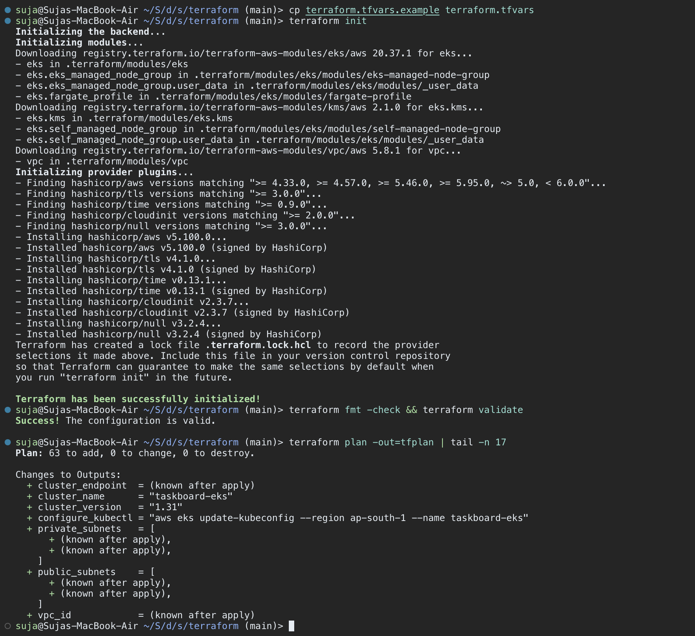
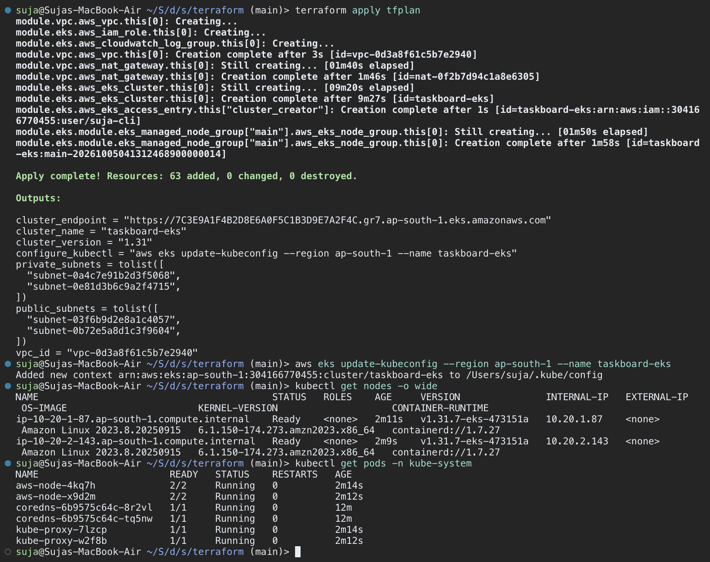
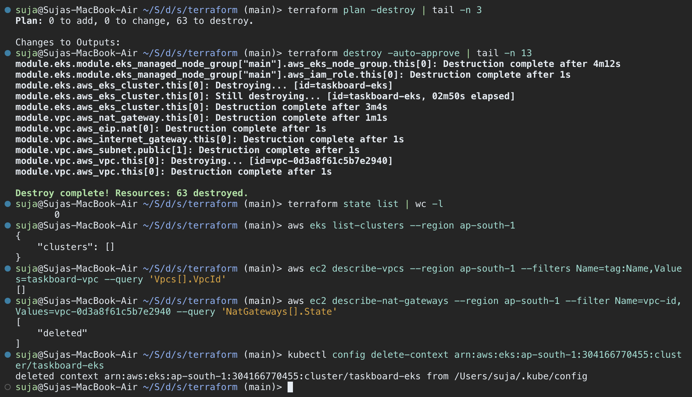

# Shared AWS Evidence

**Contributors reported by the student:** T. Abdul Kalam Azad (24BCS10053) and
Shaikh Suja Rahaman (24bcs10038).

T. Abdul Kalam Azad reports that the work was collaborative and that the instructor
permitted reuse of the shared screenshots on 15 October 2026. These images are
included on that basis, with their source and original project identity preserved.
The student's specific contribution has not yet been described in this document.

## Source And Scope

The original screenshots are from [Shaikh Suja Rahaman's Session 21 repository](https://github.com/Shaikh-Suja-Rahaman/devops-heros/tree/a966ab3a8f9772e69e786f411a9f1ccbb3765701/session21-python/screenshots),
at commit `a966ab3a8f9772e69e786f411a9f1ccbb3765701`. Its
[project report](https://github.com/Shaikh-Suja-Rahaman/devops-heros/blob/a966ab3a8f9772e69e786f411a9f1ccbb3765701/session21-python/MyReadme.md)
describes AWS infrastructure for `taskboard-eks` in `ap-south-1` and a separate
local Minikube application deployment.

These files are unchanged copies, not new captures made in this workspace.
The screenshots display Terraform plan/apply/destroy output and EKS node checks.
Their contents have not been independently verified against the AWS account.
They do **not** show that CampusDesk's Terraform configuration was applied or that
the CampusDesk application ran on EKS. CampusDesk's independently verified runtime
remains local Compose/Kind plus the ephemeral CI Kubernetes environment.

These are terminal screenshots, not AWS Console screenshots. The instructor's
acceptance of shared evidence determines which M7 requirements they satisfy;
this document does not award a grade or assert that all M7 requirements are met.

## Terraform Initialization And Plan

Shared source image displaying initialization, validation and a plan for 63 resources.

## Terraform Apply And EKS Checks

Shared source image displaying apply completion and EKS node/system-pod checks.
Original names and terminal identity are retained.

## Terraform Cleanup

Shared source image displaying destroy completion and follow-up resource queries.

## Copy Integrity

Local `git hash-object` results match the source GitHub blob IDs:

| File | Git blob ID |
|---|---|
| `01-terraform-init-plan.png` | `b58a181f705221958b81c52ac41cb0a14f676ee0` |
| `02-terraform-apply-eks.png` | `63bbaf3715ce9d597fa87a434eafbd041030e68c` |
| `35-terraform-destroy.png` | `6309c5b631075c8489d52388e3954778c4bbc6f5` |

Matching hashes establish that the downloaded files were not altered. They do not
independently establish the authenticity of the depicted AWS operations.
