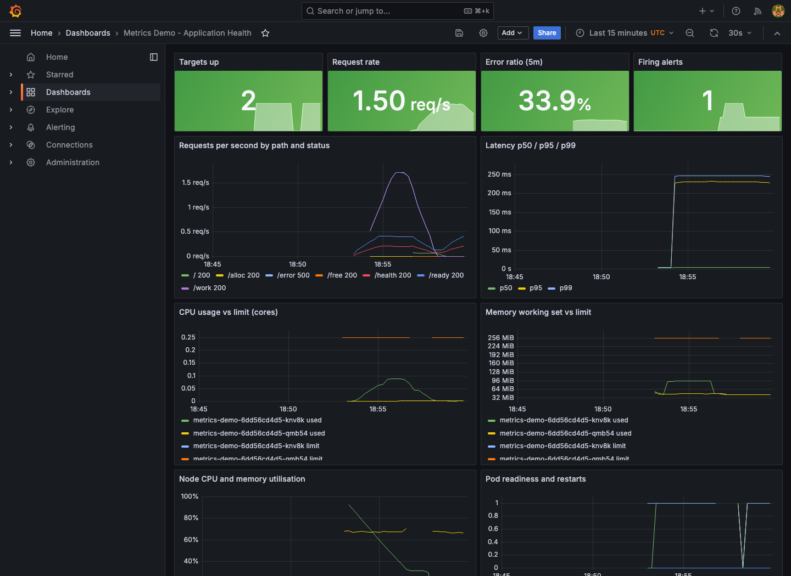

# Lab verification — 18 October 2026

**T. Abdul Kalam Azad · 24BCS10053**

This appendix links the rerun evidence for the course assignments. The submitted
READMEs and their original explanations remain in place; each now links its new
results here. Dates use Asia/Kolkata: logs timestamped 17 October UTC were captured
after midnight on 18 October locally.

## Requirements checked

The assignment list was checked against [Nency Ravaliya's devops-heros repository](https://github.com/Nency-Ravaliya/devops-heros/tree/68be534ed67dd6de7ce520821e07e4dde137e26c)
and its linked [homework document](https://docs.google.com/document/d/1cjXFYf2Thm8cBEN-0C48B-v02cj3jGLd47lcO18prHE/edit).
The [reference comparison](instructor-comparison.json) records the exact revision:
563 imported files match; later exam-practice documents and a Terraform variable
file differ. The exam-practice questions are reference material, not additional
deployment assignments. Session 8's networking and volumes work is in task 7.

## Mini-project follow-up

A [closer project review](../../LAB-PROJECT-REVIEW.md) added successful checks for Task 13's own PVC after Pod replacement and Task 15's invalid-image upgrade/rollback. These local results are in [project-followup/](project-followup/); they supplement the earlier CI run. The TaskBoard reference scope is explained in the same review.

## Task-by-task evidence

The result files identify commands, exit codes and raw logs. Kubernetes operation
counts include setup, observation and cleanup; they are not counts of independent
test cases. The table links a representative screenshot, with full results alongside.

| Task | Verified behavior | Results | Screenshot |
|---|---|---|---|
| 1 · Linux | Created and removed accounts with both adduser and useradd; checked links, permissions and archives. Read real system and kubelet service logs with journalctl. | [Recorded evidence](shell.json) | [View](screenshots/task1-linux.png) |
| 2 · Shell scripting | Ran the system-information script with default input and paths containing spaces; verified process-file creation and failure handling. | [Recorded evidence](shell-tests.txt) | [View](screenshots/task2-shell.png) |
| 3 · Networking | Ran interface, route, neighbour, socket, DNS, HTTP and traceroute commands; exercised isolated interface/address/route creation and deletion. | [Recorded evidence](task3-network-commands.txt) | [View](screenshots/task3-networking.png) |
| 4 · Git | Verified staging, tracked-file commit behavior, branch/merge and selective cherry-pick into main with a new commit hash. | [Recorded evidence](shell-tests.txt) | [View](screenshots/task4-git.png) |
| 5 · Docker applications | Built all six images and verified HTTP responses and rendered Hello World pages in a real browser, including the React JavaScript application. | [Recorded evidence](containers.json) | [View](screenshots/task5-react.png) |
| 6 · Multi-stage Docker | Built and ran the multi-stage application on host port 8080; checked its browser page, docker ps port mapping and non-root runtime. | [Recorded evidence](task6-multistage-docker-ps.txt) | [View](screenshots/task6-multistage.png) |
| 7 · Docker networking and volumes | Verified three networks, a backend connected to two networks, real MySQL queries, frontend/database isolation, Apache on host-network port 80, named-volume persistence and live bind-mount edits. | [Recorded evidence](network-retry/networks.json) | [View](screenshots/task7-networks.png) |
| 9 · Kubernetes fundamentals | Started Minikube and checked cluster/node status. Ran Kubernetes Basics: deploy, explore, expose, scale, update to v2, observe a broken image and roll back with restored HTTP responses. | [Recorded evidence](basics.json) | [View](screenshots/task9-kubernetes.png) |
| 10 · Deployments and lifecycle | Exercised rolling, Recreate, blue/green and canary deployments, update/rollback traffic, Pod phases, restart policies, init content and lifecycle/probe behavior. | [Recorded evidence](ci-homework-39060263538/homework-kubernetes/deployments.json) | [View](screenshots/task10-deployments.png) |
| 11 · Services and DNS | Verified ClusterIP, NodePort, headless and ExternalName services and DNS recovery. Provisioned a MetalLB external address and reached the LoadBalancer from a Docker client outside the cluster. | [Recorded evidence](loadbalancer.json) | [View](screenshots/task11-services.png) |
| 12 · Ingress, ConfigMaps and Secrets | Verified host/path routing, ConfigMap and Secret consumption, broken backend and ingress-class diagnosis/repair, missing ConfigMap recovery and newline handling. | [Recorded evidence](ingress.json) | [View](screenshots/task12-ingress.png) |
| 13 · Storage, HPA and probes | Verified emptyDir sharing, hostPath/PVC persistence and static Retain release/rebind. Exercised readiness failure, liveness restart and CPU-driven autoscaling. The final CI report records both scale-out and scale-down. | [Recorded evidence](storage.json) | [View](screenshots/task13-storage.png) |
| 14 · Troubleshooting | Reproduced and repaired eight scenario groups, then ran the separate mini-project: broken image, empty endpoints, repaired rollout and successful Service HTTP response. | [Recorded evidence](mini.json) | [View](screenshots/task14-troubleshooting.png) |
| 15 · Helm | Ran chart creation and repository commands, install, test, two upgrades, rollback, restored-content verification, history and uninstall. | [Recorded evidence](helm-lifecycle.json) | [View](screenshots/task15-helm.png) |
| 16 · CI/CD | Completed GitHub CI and CD, including tests, image publication to GHCR and deployment verification in an ephemeral Kubernetes cluster. | [Recorded evidence](ci-task16-39059479821/) | [View](screenshots/task16-github-cd.png) |
| 17 · DevSecOps | Completed the full test, SAST, SCA, secret scan, image scan, security gate, registry publication and Kubernetes deployment workflow. | [Recorded evidence](ci-task17-39059479655/) | [View](screenshots/task17-github-devsecops.png) |
| 18 · Terraform S3 | Applied the private versioned S3 configuration in AWS, checked public-access blocking and a no-change plan, then destroyed the bucket and verified cleanup. | [Recorded evidence](aws/results.json) | [View](screenshots/task18-terraform.png) |
| 19 · Terraform cloud project | Applied the VPC/subnet/routing/security-group/EC2/S3 project in AWS. Verified the public nginx endpoint and matching instance identity, checked a no-change plan, destroyed all 13 managed resources and verified cleanup. | [Recorded evidence](aws/task19-http.txt) | [View](screenshots/task19-terraform.png) |
| 20 · Monitoring and GitOps | Verified two Prometheus targets, CPU/memory/health metrics, a Grafana dashboard, Loki application logs and an alert moving from pending to firing to resolved. Argo CD deployed v2 from Git and restored a manual replica change from five to three. | [Recorded evidence](monitoring/result.json) | [View](screenshots/task20-grafana-dashboard.png) |
| 21 · Capstone/reference | CampusDesk is the original completed capstone. TaskBoard remains the course reference; its app tests, image build, Helm and Terraform validation are included in CI. | [CampusDesk final audit](https://github.com/abdulkalamazad1001/campusdesk-devops-capstone/blob/main/FINAL-AUDIT.md) | [CampusDesk evidence](https://github.com/abdulkalamazad1001/campusdesk-devops-capstone/tree/main/evidence/2026-10-17) |

## Pipeline evidence

**All seven homework jobs passed.** [Exact run metadata and tested revisions](github-runs.json)
and the [successful workflow screenshot](screenshots/homework-final-validation.png) are retained.


- [Homework validation, run 39060263538](https://github.com/abdulkalamazad1001/scaler-devops-homework/actions/runs/39060263538): application tests, shell, workflow lint, infrastructure validation, Docker networking, Kubernetes/Helm and both autoscaling exercises.
- [Task 16 CI, run 39059479821](https://github.com/abdulkalamazad1001/scaler-devops-homework/actions/runs/39059479821) and [CD, run 39059558499](https://github.com/abdulkalamazad1001/scaler-devops-homework/actions/runs/39059558499): test, build, publish and deployed health verification.
- [Task 17 DevSecOps, run 39059479655](https://github.com/abdulkalamazad1001/scaler-devops-homework/actions/runs/39059479655): tests, SAST, SCA, secret/image scans, policy gate, GHCR and deployment.

[Task 16 test reports](ci-task16-39059479821/) and [Task 17 security reports](ci-task17-39059479655/)
are retained in Git because Actions artifacts expire. Docker image archives and
build caches are excluded from this evidence folder.

### Retained reports from the final homework run

- [Application tests](ci-homework-39060263538/homework-apps/apps.json): 106 tests across tasks 16, 17, 20 and 21.
- [Infrastructure](ci-homework-39060263538/homework-infra/infra.json): Helm rendering, Terraform validation and monitoring rules.
- [Docker networks and mounts](ci-homework-39060263538/homework-containers/networks.json): all 32 recorded operations passed.
- [Deployment strategies](ci-homework-39060263538/homework-kubernetes/deployments.json), [DNS recovery](ci-homework-39060263538/homework-kubernetes/dns.json) and [eight troubleshooting scenario groups](ci-homework-39060263538/homework-kubernetes/troubleshooting.json).

- [PHP/Apache autoscaling](ci-homework-39060263538/homework-autoscaling/hpa-walkthrough.json) and [mini-project recovery](ci-homework-39060263538/homework-autoscaling/probes.json): both scale-out and scale-down passed. [View replica observations](screenshots/task13-autoscaling.png). The HPA status table can lag Deployment status; the recovery assertions inspect the desired and ready Deployment replicas directly.

## Screenshots and provenance

These are actual browser captures of the [six Docker apps](screenshots/),
[multi-stage app](screenshots/task6-multistage.png),
[GitHub CD](screenshots/task16-github-cd.png),
[DevSecOps pipeline](screenshots/task17-github-devsecops.png),
[Grafana dashboard](screenshots/task20-grafana-dashboard.png),
[Prometheus targets](screenshots/task20-prometheus-targets.png) and
[Argo CD application](screenshots/task20-argocd-gitops.png).

For command-line labs, the screenshots are clearly labelled **views of saved
execution logs**, with verbatim excerpts. They are not live terminal or AWS Console
captures. [The source manifest](screenshots/log-viewer-sources.json) maps each image
to its complete transcript. The older expected-output images in the assignment
folders retain their original labels and are not used as rerun proof.



## Environments and boundaries

- Local Docker and Minikube ran on Apple Silicon. Minikube used Kubernetes 1.35.0;
  the disposable profile was named `homework-review`. The [resource adjustment](minikube-resource-adjustment.txt)
  increased its allocation to 4 CPUs/4 GiB after an observed monitoring timeout.
- Docker host networking refers to the Linux Docker VM, not the macOS network namespace.
  The MySQL empty-password fixture was disposable and had no published database port.
- MetalLB assigned an address on the local Docker network. Its HTTP check came from
  outside the Kubernetes cluster on that network; it is not a public cloud load balancer.
- GitHub's Ubuntu/AMD64 runners hosted disposable Kind clusters. The official PHP/Apache
  HPA example ran there; scale-down retained the normal stabilization delay.
  The metrics-server insecure-kubelet-TLS option is confined to those test clusters.
- Task 16/17 deployment jobs use ephemeral Kind, not a persistent AWS staging service.
- Tasks 18/19 ran against real AWS in `ap-south-1`. The public EC2 endpoint was checked
  before teardown; it is no longer a live demonstration URL. [AWS command records](aws/results.json)
  and [cleanup queries](aws/cleanup-verified.json) accompany the Terraform transcripts.
- Traceroute recorded filtered/timed-out hops. This is preserved as observed output,
  not presented as successful discovery of every Internet hop.
- The TaskBoard reference was not separately deployed end to end to AWS. The original
  capstone is CampusDesk, whose independent evidence and videos are linked above.

## Failures diagnosed and fixed

- MySQL's temporary initialization server caused a premature readiness result. The
  check now waits for TCP readiness before executing queries. The [initial result](networks-initial.json)
  and [successful rerun](network-retry/networks.json) are both retained.
- The Linux CI bind-mount fixture initially had a private directory mode, producing
  an Nginx 403. Explicit directory/file permissions fixed it; the current container
  job passed. The earlier [run 39059479636](https://github.com/abdulkalamazad1001/scaler-devops-homework/actions/runs/39059479636)
  is retained as failure history. The final run supplies the successful Kubernetes
  artifact for the deployment/lifecycle and DNS exercises.
- The monitoring stack initially saturated its small local allocation. The
  [timeout](monitoring/initial-timeout.txt) remains recorded. After the resource change,
  both targets, metrics, logs, webhook delivery and alert resolution were verified.

## Evidence hygiene

A [Gitleaks review](evidence-secret-review.json) found two matches for the official Python image's public GPG fingerprint in Trivy metadata; both were checked against the upstream Dockerfile. No credentials were identified. AWS state, local credential helpers, image archives and screenshot-generation tools remain outside the published evidence.

## Cleanup

Task 18's bucket and all 13 task 19 managed resources were destroyed. The follow-up
AWS queries found no matching lab VPC, running instance or bucket. This is resource
cleanup evidence, not an exact billing statement.

The local [Minikube profile was deleted](minikube-cleanup.txt), and the separate
[GitOps application](gitops-cleanup.txt) and [namespace](gitops-namespace-cleanup.txt)
were removed. The existing [CampusDesk application remained Synced and Healthy](campusdesk-preserved.txt).
Docker demo containers and networks have their individual cleanup logs. GitHub's
lab clusters are discarded with their hosted runners.

## Reproduce the checks

Start with the instructions in each task README and use a disposable cluster.
The reusable runners are in [review/](../../). For example:

```bash
python review/check_sources.py
python review/run_checks.py apps
python review/run_checks.py shell
python review/run_checks.py infra
python review/smoke_containers.py
python review/check_networks.py
python review/check_kubernetes.py --context YOUR_LAB_CONTEXT
python review/check_helm_lifecycle.py --context YOUR_LAB_CONTEXT
python review/check_remaining_labs.py --context YOUR_LAB_CONTEXT --suite basics
python review/check_hpa.py --context YOUR_AMD64_LAB_CONTEXT
python review/check_lab_scenarios.py --context YOUR_LAB_CONTEXT --suite probes
```

Use `HOMEWORK_RESULTS_DIR` to keep a new run separate from these records. For browser
screenshots, install the dependencies in `review/package.json` and Playwright Chromium,
then set `HOMEWORK_BROWSER_CHECKS=1`. AWS commands require your own credentials and
an explicit cleanup plan; state and credentials are excluded from Git.
