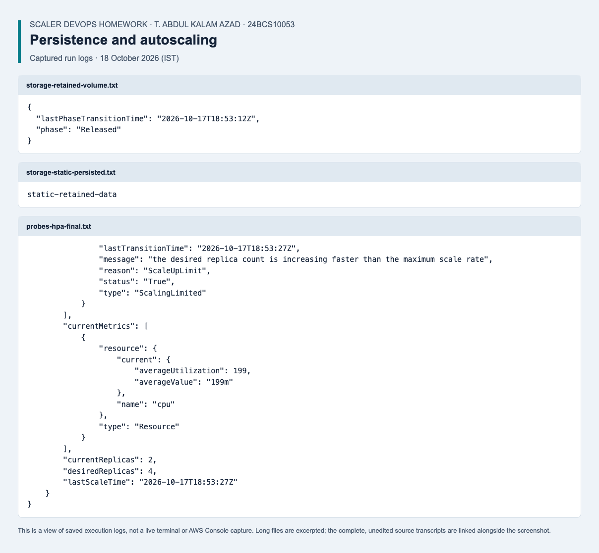
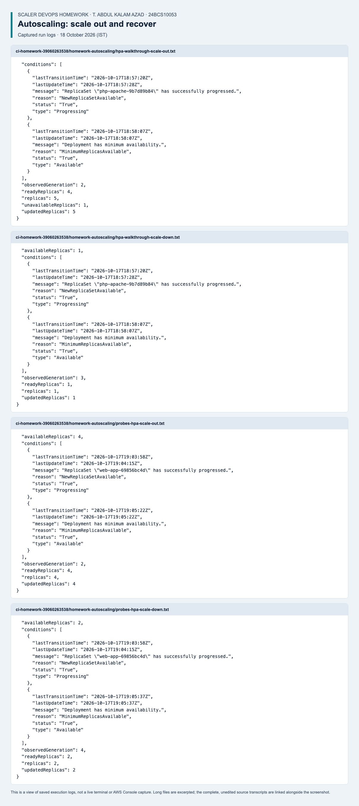

# Storage, HPA and Probes

Student: T. Abdul Kalam Azad, 24BCS10053.

## Deliverables

- [Volume labs](01-kubernetes-volumes/README.md): emptyDir, hostPath, static PV/PVC, dynamic provisioning and retention.
- [HPA load generator](02-hpa/load-generator.yaml): generate traffic for the scaling exercise.
- [Mini-project](03-mini-project/): nginx Deployment, PVC, Service, startup/readiness/liveness probes and CPU HPA.

## Requirements and Verification

The mini-project uses the `standard` StorageClass and needs a working metrics-server
for CPU-based autoscaling. It starts with two replicas and allows up to five.
Its ReadWriteOnce volume can be shared by Pods on one node, not arbitrary nodes
across a multi-node cluster. Run load tests only on an isolated lab cluster.

From the repository root, the following runner creates a unique namespace,
checks readiness failure and liveness recovery, applies bounded CPU load, observes
scale-out and deletes the test namespace:

```bash
python -m pip install PyYAML==6.0.3
python review/check_lab_scenarios.py --context kind-campusdesk --suite probes
```

Replace the context with your local lab context. The volume examples use node
paths and reclaim policies that require separate review before running on a
cluster with important data; the runner does not alter those cluster-wide objects.

## Evidence

- [Assignment write-up and commands](submission.md)
- [Current verification results and remaining work](../review/README.md)

The output and terminal-style images in the original write-up are labelled expected
output, not captures from a live deployment. Current test logs are kept separately
under the project review. Validation alone does not prove every exercise was run.

## Verified rerun — 18 October 2026

Verified emptyDir sharing, hostPath/PVC persistence and static Retain release/rebind. Exercised readiness failure, liveness restart and CPU-driven autoscaling. The final CI report records both scale-out and scale-down.

[Recorded results](../review/results/2026-10-18/storage.json) · [Screenshot](../review/results/2026-10-18/screenshots/task13-storage.png) · [Complete evidence index and environment notes](../review/results/2026-10-18/README.md).

Autoscaling runs on an AMD64 GitHub runner using the course PHP/Apache example and the separate mini-project. See the [final CI run](https://github.com/abdulkalamazad1001/scaler-devops-homework/actions/runs/39060263538) for the default cooldown and replica recovery checks.



*Saved execution log view from the verified rerun; complete results are linked above.*

### Autoscaling recovery evidence

Both exercises passed in the final CI run: PHP/Apache returned to one ready replica, and the mini-project returned to two. The assertions check desired and ready Deployment replicas; HPA status-table values can lag during reconciliation.



[PHP/Apache report](../review/results/2026-10-18/ci-homework-39060263538/homework-autoscaling/hpa-walkthrough.json) · [Mini-project report](../review/results/2026-10-18/ci-homework-39060263538/homework-autoscaling/probes.json).
