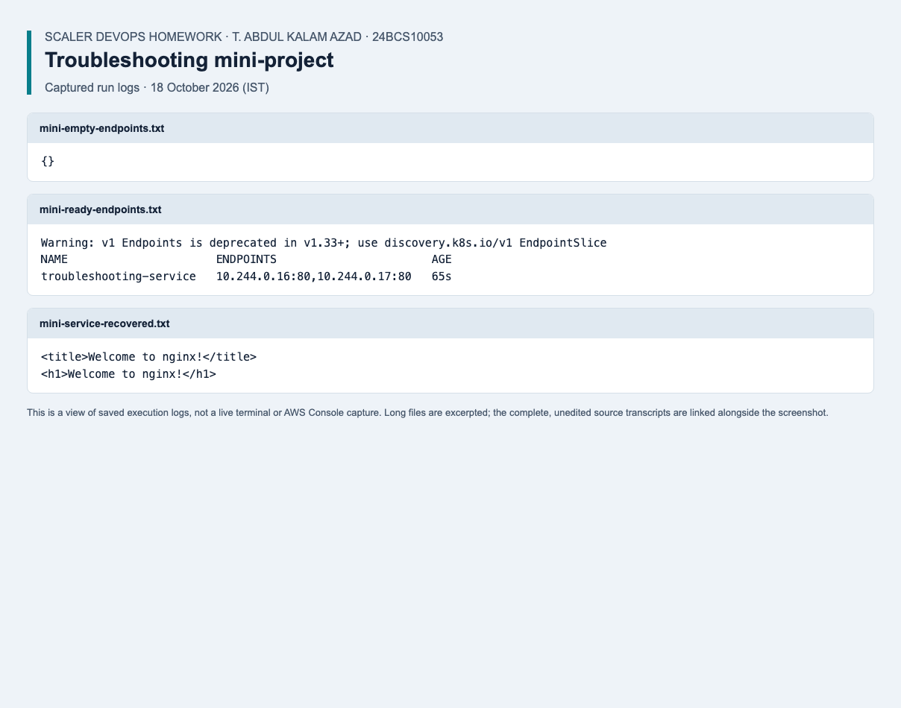

# Kubernetes Troubleshooting

Student: T. Abdul Kalam Azad, 24BCS10053.

## Deliverables

- [kubectl basics](01-kubectl-basics/): inspect Pods, logs and Deployments.
- [Failure scenarios](02-scenarios/): crash loops, invalid images, unschedulable
  Pods, missing ConfigMaps, Service selectors/ports, cross-namespace DNS,
  loopback-only servers, Secret keys and memory limits.
- [Mini-project](03-mini-project/): diagnose and repair the broken Pod/Service.

Each `broken*.yaml` is intentionally faulty. Its matching `fixed*.yaml` is the
repair. Do not apply the entire directory at once: several files describe different
versions of the same object, and some Pod fields require deletion/recreation.

## Reproduce Failure and Recovery

Use a disposable local cluster. From the repository root:

```bash
python -m pip install PyYAML==6.0.3
python review/check_lab_scenarios.py --context kind-campusdesk --suite troubleshooting
python review/check_lab_scenarios.py --context kind-campusdesk --suite dns
```

The runner requires observing each expected failure before checking its repair.
It isolates namespaces and removes them afterward; it does not modify CampusDesk.
For the DNS exercise, the fixed `production` namespace is replaced only in the
test input with a unique server namespace to avoid touching existing workloads.

## Evidence

- [Assignment write-up and commands](submission.md)
- [Current verification results and remaining work](../review/README.md)

The output and terminal-style images in the original write-up are labelled expected
output, not captures from a live deployment. Current test logs are kept separately
under the project review. Validation alone does not prove every exercise was run.

## Verified rerun — 18 October 2026

Reproduced and repaired eight scenario groups, then ran the separate mini-project: broken image, empty endpoints, repaired rollout and successful Service HTTP response.

[Recorded results](../review/results/2026-10-18/mini.json) · [Screenshot](../review/results/2026-10-18/screenshots/task14-troubleshooting.png) · [Complete evidence index and environment notes](../review/results/2026-10-18/README.md).



*Saved execution log view from the verified rerun; complete results are linked above.*
