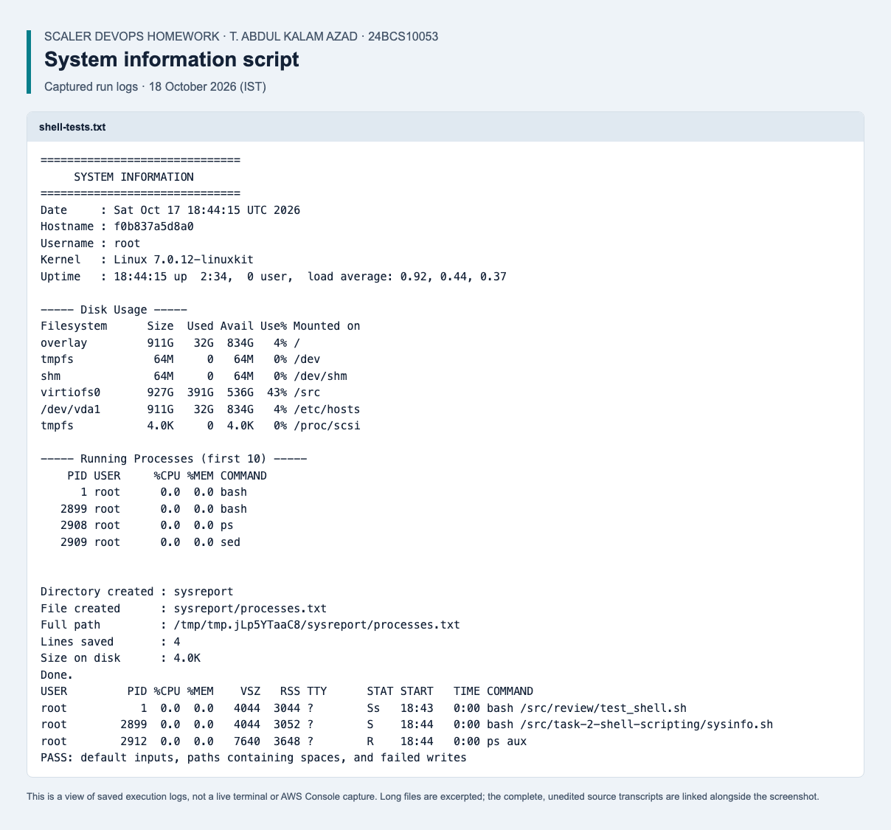

# System Information Script

Name: T. Abdul Kalam Azad

Roll number: 24BCS10053

A shell script that prints basic system details, asks the user where to save a report,
and writes the full list of running processes into a file.

## What it does

1. Prints the current date, the hostname and the username, all stored in variables.
2. Also prints the kernel version and the uptime, so the header is a fuller picture.
3. Prints disk usage with df -h.
4. Prints the first ten running processes with ps.
5. Uses read -p to ask for a directory name and a file name, with defaults if left blank.
6. Creates the directory with mkdir and the file with touch.
7. Saves the full process list into that file using the > redirection operator.
8. Prints a summary: the absolute path of the report, its line count and its size.

## Commands used

mkdir, touch, echo, date, hostname, whoami, uname, uptime, df, ps, du, wc, read -p,
variables, and > redirection.

## The script

    #!/bin/bash
    # System Information Script
    # Prints basic system details, then saves the running processes to a file.
    #
    # Author : T. Abdul Kalam Azad
    # Roll no: 24BCS10053

    # Stop before reporting success if collecting or writing the report fails.
    set -euo pipefail

    # Variables holding the system details
    CURRENT_DATE=$(date)
    HOST_NAME=$(hostname)
    USER_NAME=$(whoami)
    KERNEL=$(uname -sr)
    UP_TIME=$(uptime | sed 's/^ *//')

    echo "=============================="
    echo "     SYSTEM INFORMATION"
    echo "=============================="
    echo "Date     : $CURRENT_DATE"
    echo "Hostname : $HOST_NAME"
    echo "Username : $USER_NAME"
    echo "Kernel   : $KERNEL"
    echo "Uptime   : $UP_TIME"
    echo ""

    echo "----- Disk Usage -----"
    df -h
    echo ""

    echo "----- Running Processes (first 10) -----"
    ps -eo pid,user,%cpu,%mem,comm | sed -n '1,10p'
    echo ""

    # Ask the user where to save the report.
    # Initialised first so that `set -u` is safe if read hits end of input.
    DIR_NAME=""
    FILE_NAME=""
    read -r -p "Enter a directory name to create [sysreport]: " DIR_NAME || true
    read -r -p "Enter a file name for the process list [processes.txt]: " FILE_NAME || true

    # Fall back to sensible defaults if the answer was left blank
    DIR_NAME=${DIR_NAME:-sysreport}
    FILE_NAME=${FILE_NAME:-processes.txt}

    REPORT="$DIR_NAME/$FILE_NAME"

    mkdir -p "$DIR_NAME"
    touch "$REPORT"

    # Save the full process list into the file
    ps aux > "$REPORT"

    echo ""
    echo "Directory created : $DIR_NAME"
    echo "File created      : $REPORT"
    echo "Full path         : $(cd "$DIR_NAME" && pwd)/$FILE_NAME"
    echo "Lines saved       : $(wc -l < "$REPORT" | tr -d " ")"
    echo "Size on disk      : $(du -h "$REPORT" | cut -f1)"
    echo "Done."

## How to run it

    chmod +x sysinfo.sh
    ./sysinfo.sh

It will ask for a directory name and a file name. I used sysreport and processes.txt.
Pressing Enter at either prompt accepts the default shown in the square brackets.

## Output

    ==============================
         SYSTEM INFORMATION
    ==============================
    Date     : Thu Sep  3 19:25:25 IST 2026
    Hostname : Abduls-MacBook-Pro.local
    Username : abdulkalamazad
    Kernel   : Darwin 25.6.0
    Uptime   : 19:25  up 10:46, 1 user, load averages: 1.74 1.81 1.70

    ----- Disk Usage -----
    Filesystem        Size    Used   Avail Capacity  Mounted on
    /dev/disk3s1s1   926Gi    12Gi   829Gi     2%    /
    devfs            200Ki   200Ki     0Bi   100%    /dev
    /dev/disk3s6     926Gi    20Ki   829Gi     1%    /System/Volumes/VM
    /dev/disk3s2     926Gi   8.5Gi   829Gi     2%    /System/Volumes/Preboot
    /dev/disk3s4     926Gi   3.7Mi   829Gi     1%    /System/Volumes/Update
    /dev/disk3s5     926Gi    75Gi   829Gi     9%    /System/Volumes/Data

    ----- Running Processes (first 10) -----
      PID USER              %CPU %MEM COMM
        1 root               0.1  0.1 /sbin/launchd
      330 root               0.6  0.2 /usr/libexec/logd
      331 root               0.0  0.0 /usr/libexec/smd
      332 root               0.0  0.1 /usr/libexec/UserEventAgent
      334 root               0.0  0.0 .../FSEvents.framework/Support/fseventsd
      335 root               0.0  0.1 .../MediaRemote.framework/Support/mediaremoted
      338 root               0.0  0.1 /usr/sbin/systemstats
      340 _accessoryupdater  0.0  0.0 .../Support/accessoryupdaterd
      341 _accessoryupdater  0.0  0.0 /usr/libexec/uarpassetmanagerd

    Enter a directory name to create [sysreport]: sysreport
    Enter a file name for the process list [processes.txt]: processes.txt

    Directory created : sysreport
    File created      : sysreport/processes.txt
    Full path         : /Users/abdulkalamazad/Documents/scaler-devops-homework/task-2-shell-scripting/sysreport/processes.txt
    Lines saved       : 707
    Size on disk      : 176K
    Done.

The disk usage and process lists above are trimmed so they fit here, the script prints
the full output. The real df -h on macOS also has iused, ifree and %iused columns, and
the long framework paths in the process list are shortened with dots.

## Checking the file that was created

    $ ls -l sysreport/
    -rw-r--r--  1 abdulkalamazad  staff  163035  3 Sep 21:22 processes.txt

    $ head -3 sysreport/processes.txt
    USER               PID  %CPU %MEM      VSZ    RSS   TT  STAT STARTED      TIME COMMAND
    abdulkalamazad     677  13.7  3.2 436929024 814864   ??  S     8:39AM  35:30.69 /Applications/WhatsApp.app/...
    abdulkalamazad    7212   5.0  1.1 1949553920 267920  ??  S     4:43PM   6:50.36 /Applications/Visual Studio Code.app/...

    $ wc -l sysreport/processes.txt
         693 sysreport/processes.txt

The line count is 707 in the script's own summary and 693 here, because the second number
comes from a later run. The process list is a snapshot, so it changes every time. The two
command lines above are also cut short with dots, because a GUI app's full command line
runs to several hundred characters.

## Notes

I ran this on macOS, so the hostname, disk names and process names look Apple specific.
On Linux the same script works unchanged, only the output looks different, for example
df -h shows /dev/sda1 style filesystems and uname -sr shows something like
Linux 6.8.0-45-generic.

The ps line uses -eo pid,user,%cpu,%mem,comm because plain ps aux prints very long
command lines that wrap badly. The full ps aux output is still what gets saved to the
file.

mkdir -p is used instead of plain mkdir so that re-running the script does not fail with
a directory already exists error.

The variables are quoted, as in "$DIR_NAME/$FILE_NAME", so that names with spaces still
work.

The current script uses `set -euo pipefail` so failed writes cannot print a success
message. `sed -n '1,10p'` consumes the full process stream while printing only ten
lines, avoiding the SIGPIPE that `head` can cause. `read -r ... || true` preserves
literal backslashes and accepts defaults when input reaches EOF. The historical
output above is unchanged; current Linux regression checks live in
[the project review](../review/README.md).

wc -l < file is piped through tr -d " " because macOS pads the count with spaces, so the
summary line would otherwise read "Lines saved :      707".

## Verified rerun — 18 October 2026

Ran the system-information script with default input and paths containing spaces; verified process-file creation and failure handling.

[Recorded results](../review/results/2026-10-18/shell-tests.txt) · [Screenshot](../review/results/2026-10-18/screenshots/task2-shell.png) · [Complete evidence index and environment notes](../review/results/2026-10-18/README.md).

*Saved execution log view from the verified rerun; complete results are linked above.*
