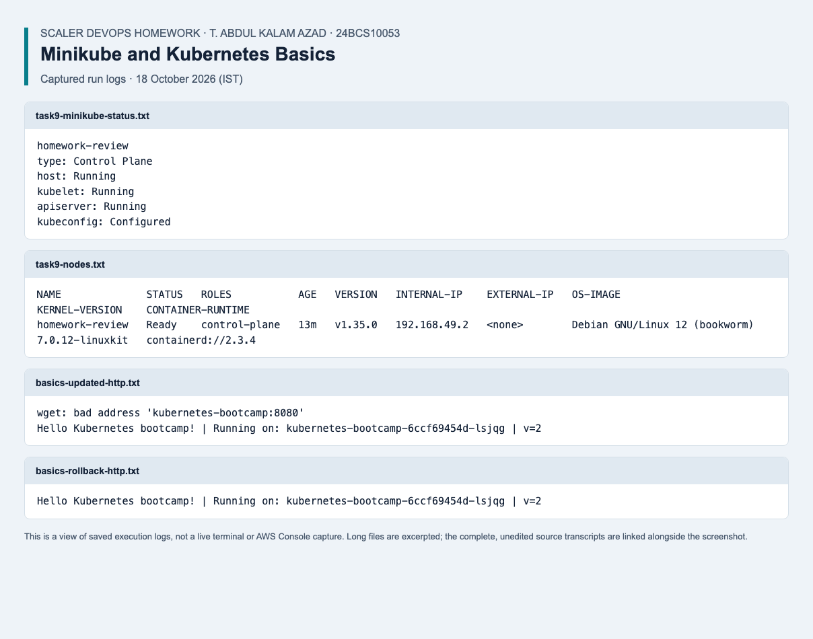

# Kubernetes Fundamentals

Student: T. Abdul Kalam Azad, 24BCS10053.

## Deliverables

- Kubernetes architecture, control-plane components and basic commands: [write-up](submission.md).
- Ubuntu/Linux amd64 installation with checksum verification: [installer](install-minikube.sh).
- Standalone nginx Pod and bootcamp Deployment: [manifests](manifests/).

## Run the Pod Lab

Use a disposable Kubernetes cluster with `kubectl` configured. From this directory:

```bash
kubectl create namespace homework-fundamentals
kubectl -n homework-fundamentals apply -f manifests/nginx-pod.yaml
kubectl -n homework-fundamentals wait --for=condition=Ready pod/nginx-pod --timeout=180s
kubectl -n homework-fundamentals get pods -o wide
kubectl delete namespace homework-fundamentals
```

The installer is for Linux amd64, not native Windows. The recorded runtime check
used Kind; it does not establish that the Minikube installation was executed.

## Evidence

- [Assignment write-up and commands](submission.md)
- [Current verification results and remaining work](../review/README.md)

The output and terminal-style images in the original write-up are labelled expected
output, not captures from a live deployment. Current test logs are kept separately
under the project review. Validation alone does not prove every exercise was run.

## Verified rerun — 18 October 2026

Started Minikube and checked cluster/node status. Ran Kubernetes Basics: deploy, explore, expose, scale, update to v2, observe a broken image and roll back with restored HTTP responses.

[Recorded results](../review/results/2026-10-18/basics.json) · [Screenshot](../review/results/2026-10-18/screenshots/task9-kubernetes.png) · [Complete evidence index and environment notes](../review/results/2026-10-18/README.md).



*Saved execution log view from the verified rerun; complete results are linked above.*
